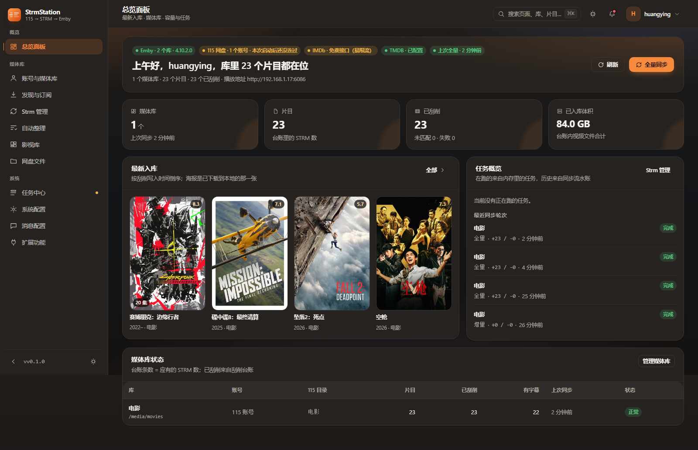
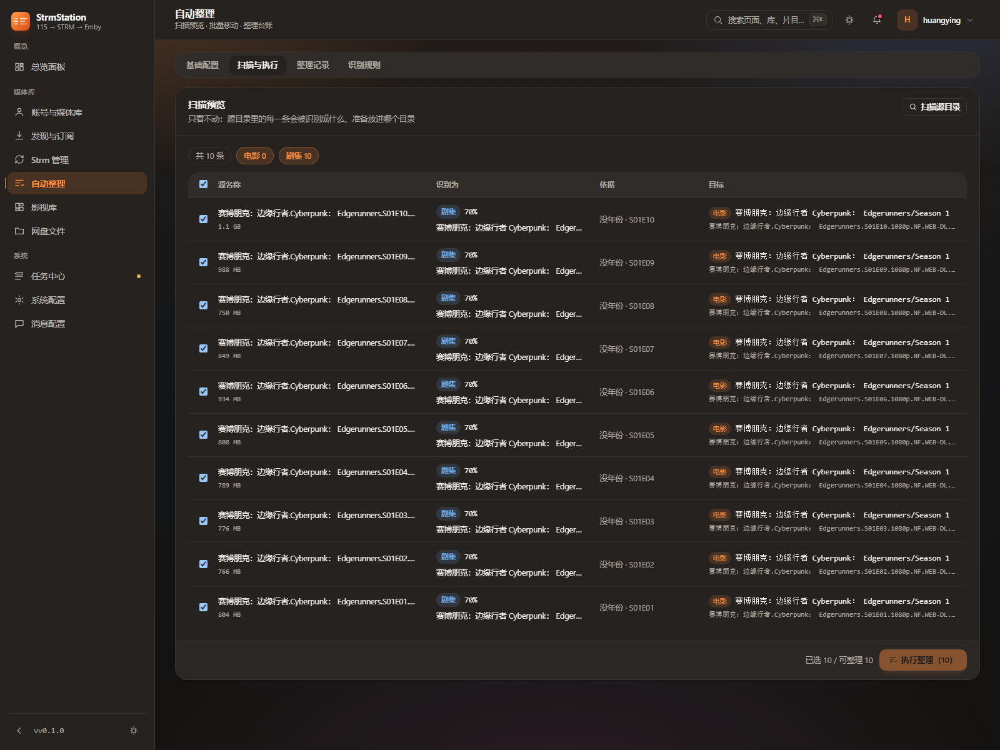
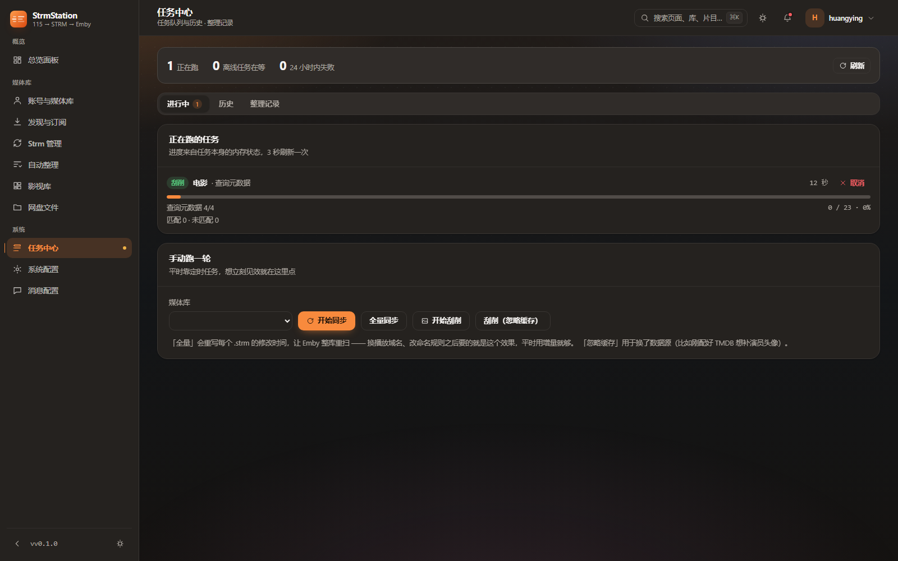
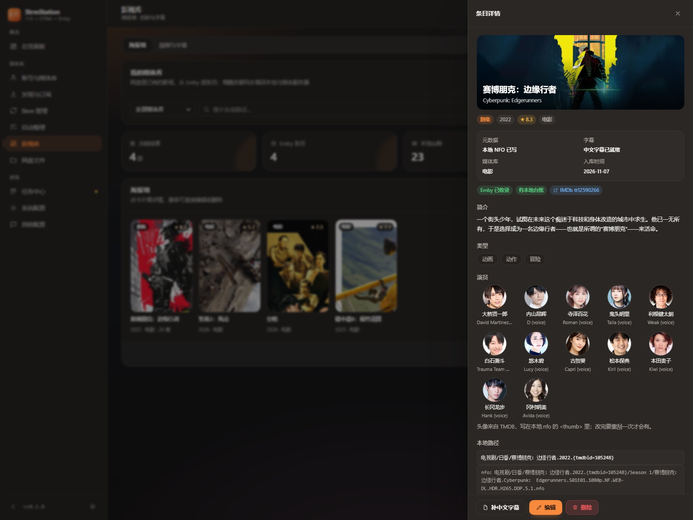

# strm115

把 115 / 夸克网盘的媒体目录映射成本地 `.strm` 文件，供 Emby / Jellyfin 入库；
播放时由本机返回一次 **302** 让播放器直连网盘 CDN —— 服务器只转发重定向，不转发媒体流量。
离线下载只走 115；TG 频道里搜到的夸克分享走「网页 Cookie 转存 + 夸克TV 直链」。

> 从零实现，v0.1。技术栈刻意选得低维护：**Go 单二进制 + 内嵌前端 + SQLite（纯 Go，无 CGO）**，
> 没有 Node 构建、没有外部中间件、没有 ORM。
> 交付形态是**一个容器**：二进制约 13MB，运行镜像基于 alpine，启动后常驻内存几十 MB。



---

## 它是怎么工作的

```
① 登录 115（扫码 / Cookie）
        ↓
② 选一个网盘目录，建「媒体库」（网盘目录 ↔ 本地目录 的映射）
        ↓
③ 全量遍历：目录 → 视频文件 → 本地写 xxx.strm，内容是一行 URL
        ↓
④ Emby 里加库，指向本地目录；Emby 只认本地文件，.strm 是它官方的「远程流」机制
        ↓
⑤ 播放：播放器 → :6086/d/{pickcode} → 302 → 115 CDN（直连，不过本机）
```

`.strm` 文件的内容长这样：

```
http://NAS:6086/d/abc123def.mkv?/流浪地球 (2019).mkv
```

- 路径段带扩展名：播放器判断「能否直放」看的是 URL 最后一段，不带扩展名会被要求转码。
- `?/文件名` 是装饰，让 Emby 不用额外发请求就知道是什么文件。
- 本机收到 `/d/abc123def.mkv` 会剥掉扩展名，用 `abc123def` 去换直链。

### Emby 302 网关：三种播放方式

Emby 播 `.strm` 时会自己把字节拉下来再转发给播放器（服务器中转）。在
「系统配置 → 播放直连（302 网关）」打开后，网关挡在 Emby 前面改写
`PlaybackInfo` 响应，**客户端拿到什么播放地址由我们决定**，视频字节不再经过 NAS：

| 模式（`emby_gateway_mode`） | Path / DirectStreamUrl | 适用 |
|---|---|---|
| `redirect`（默认） | 都指向相对 `/Videos/{id}/stream?Static=true`，网关 302 到 CDN | 兼容性最好；相对地址自动跟随客户端的协议 / 域名 / 反代前缀 |
| `hybrid` | Path 给按客户端当前域名归一化的 `/d/` 直链，DirectStreamUrl 保留统一入口 | 支持 DirectPlay 的播放器少一跳、完全不碰 Emby，其余客户端仍有兜底 |
| `direct` | 只给 `/d/` 直链并关掉 DirectStream | STRMhub 式的最短路；个别客户端不认绝对 Path 时换回 `hybrid` |

三档都会：关掉 `SupportsTranscoding` 并删掉 `TranscodingUrl`（不让客户端挑 HLS）、
把 `Container` 从 `strm` 改回真实容器、把客户端自己的凭据与 `UserId` 带回播放地址
（Bearer / `ApiKey` / `MediaBrowser` 复合头都认）、在**打开条目详情**与 **PlaybackInfo**
两个阶段提前把直链换好（冷解析不落在起播关键路径上）。`.strm` 里写死的内网地址会按
客户端实际访问的 host 归一化，所以公网和局域网共用一份库都能直连；算不出客户端域名时
自动退回 `redirect`，不会播不了。

---

## 电影墙 → 资源搜索 → 离线下载 → 自动同步 → 推送通知

除了「把已有网盘目录映射成 `.strm`」，还有一个反向入口：**在电影墙看到一部片，
怎么让它自动变成 Emby 里的一个条目**。链路如下：

```
① 电影墙（TMDB 中文榜）点开一部片：简介 / 评分 / 平台，外加一轮资源搜索
        ↓  后端用 TMDB（退回 IMDb）换英文原名：TG 中文 + 英文各搜一遍、种子站按英文搜
② 结果里挑一条 → 提交到 115 离线下载（指定保存目录）
        ↓  offline.Service 每 45 秒轮询任务列表
③ 任务下完 → 触发该目录对应的媒体库做一次增量同步 → Emby 自动刷新
        ↓
④ 推送一条通知（同步完成 / 失败 / 离线下载完成 / 失败）
```

**分四层，每层都能单独用**：

| 层 | 包 | 干什么 | 单独可用的意义 |
|---|---|---|---|
| 搜索 | `internal/resource` | TG 公开频道 + 7 个种子站并发搜，统一结构 | 每源独立超时、独立缓存；挂一个不影响别的 |
| 元数据 | `internal/tmdb` + `internal/imdb` | 中文标题/海报/评分；中文名换英文原名 | 在设置页填自己的 TMDB Key（源码不内置任何 Key） |
| 提交 | `internal/offline` | 提交任务、盯着它们直到出结果 | 网盘不支持离线时整块自动隐藏 |
| 通知 | `internal/notify` | 8 个渠道的推送 | 不配就是不发，不报错 |

> 「找片」页（粘磁力/链接 → 识别 → 提交）已经下线：识别能力本身还在
> （`internal/linkparse` + `internal/find`，接口 `POST /api/find`），只是不再占一个导航页。

### 离线下载为什么是「可选能力」
`pan.Driver` 只有 9 个必需方法。离线下载放在**可选接口** `pan.OfflineDownloader` 里：

```go
type OfflineDownloader interface {
    AddOfflineURIs(ctx context.Context, uris []string, saveDirID string) ([]string, error)
    ListOfflineTasks(ctx context.Context, page int64) ([]pan.OfflineTask, int64, error)
}
```

`Manager` 用类型断言探测：实现了就走节流通道，没实现就返回 `pan.ErrUnsupported`（HTTP 501）。
新接一个网盘时，不支持离线就不用写空实现，界面也不会出现一个点了没反应的按钮。

### 115 离线下载：老通道已废弃

踩过的坑，别再踩回去：

- `lixianssp/?ac=add_task_urls` 是老的 RSA 加密通道（把 `url[0]`、`url[1]`… 塞进加密 JSON）。
  **115 已经把它关了**，现在恒定返回纯文本 `decode fail!`。
  上游 SDK 的 `AddOfflineTaskURIs` 还在这条路上，会把它当成 JSON 去解，于是你看到的报错是
  误导性的 `invalid character 'd' looking for beginning of value`。
- 现在走网页端签名方案（见 `internal/pan/driver115/offline.go`）：
  `GET /?ct=offline&ac=space` 取 `sign`/`time` → `POST /web/lixian/?ct=lixian&ac=add_task_url`。
  **一次只收一条链接**，回包是单个 `info_hash`，所以批量提交在驱动里逐条发。
- 任务列表接口（`lixian.115.com/lixian/?ct=lixian&ac=task_lists`）没跟着改，SDK 的实现仍可用。
- `percentDone` 本来就是百分数（`95.69` 表示 95.69%），别再乘 100。

### 夸克：TG 里的夸克分享怎么进库

夸克这条链路和 115 是**两套接口**，接之前先弄清各自能干什么，否则会一直等一个
「为什么转存没反应」的答案：

| 能力 | 走哪套接口 | 凭证 | 有效期 |
|---|---|---|---|
| 列目录、取 302 直链（播放） | 夸克TV 开放接口 `open-api-drive.quark.cn` | 扫码 → `refresh_token` | 长期，自动刷新 |
| 转存别人的分享 | 夸克网页接口 `drive-pc.quark.cn/1/clouddrive` | 网页 Cookie | 会话字段会轮换，**系统自动续期** |

为什么不用一套：**TV 接口没有分享转存**（官方只开放了 list / download 两个方法），
而网页接口的下载直链基本都要会员、还得服务端中转。所以分工是：

```
TG 频道（yunpanquark / quarkshare 全是 pan.quark.cn 分享）
  → 认出分享码与提取码（internal/resource）
  → 网页 Cookie 转存进你的夸克网盘（internal/quark）
  → 夸克TV 列目录 → 写 .strm → /d/{fid} → 302 → 夸克 CDN
```

- 建库、同步、播放、目录浏览全部沿用原来那套 `pan.Manager`：夸克账号建出来的库和
  115 库在界面上没有区别，`sync` / `play` 一行没改。
- 夸克TV 的 fid 直接当 `pick_code` 存进台账，播放时按它反查账号换直链。
- 驱动不支持的操作（上传 / 移动 / 改名 / 删除 / 按 id 查条目）一律返回
  `pan.ErrUnsupported`，界面不会出现点了没反应的按钮。
- 配置：**账号页**选「夸克TV」扫码（播放），再在账号卡片上点「配 Cookie」拿转存能力。
  弹窗里可以**直接生成二维码用手机夸克扫**，不用开 F12 复制；也可以手动粘贴整段 Cookie。
  转存落点与反代根也在同一个弹窗里（`quark_save_fid` / `quark_web_base` / `quark_tv_base`，
  留空 = 官方地址）。**「保存到夸克目录」是网盘目录选择器**：点「选择目录」逐级浏览
  夸克里的文件夹，选中后自动记住 fid，不用再去浏览器地址栏抄那串 32 位字符；
  旁边「用根目录」一键回到 `fid=0`。这个选择器同时给 115 转存用，按账号类型
  自动决定列哪个网盘（`DirPicker.vue` 的 `account-kind`）。

踩坑记录（别重犯）：

- 签名 `x-pan-token = sha256("METHOD&/path&ts&signKey")`，path 必须和真实路径一模一样，
  连 query 都不能带进去；`device_id` 从扫码到播放必须全程一致。
- `updated_at` 是毫秒时间戳（`time.UnixMilli`），按秒解会得到 1970 年。
- `/file?method=list` 的 `page_size` **只收 1–100**，传 200 会直接回
  `"/file: page_size 范围: 1-100"`。上层列目录统一用 200（115 一页能拿 200 条），
  所以驱动实现 `MaxPageSize()` 声明上限，由 `pan.Manager.ListAll` 自动收敛；
  否则账号卡片「校验凭据」会把这句参数错误当成凭据失效显示出来。
- 夸克直链不按 UA 签名，但 API 侧要求 UA 必须是那台「TV 设备」；
  115 正好相反（空 UA 必须原样透传），两边的注释里都写明了。
- 转存是异步任务：`sharepage/save` 只回 `task_id`，必须轮询 `/task` 到
  `status=2 && task_status=2` 才算完成，否则会「提示成功但网盘里没有」。
- 网页 Cookie 里的 `__puus` 大约 3 小时轮换，但夸克只在「请求里没带 `__puus`」时
  才重新下发（见 AlistGo/alist#830）。所以 `quarkKeep` 每 ~100 分钟故意删掉它去请求
  一次只读的 `/config`，把响应里的新值合并回 Cookie 并写回账号表；普通请求的
  `Set-Cookie` 也会合并。**只要进程不长期停机，就不用重贴 Cookie**。
- 网页扫码登录用的是 CAS：`getTokenForQrcodeLogin` 拿 token（要带 `Origin` 且校验
  `status=2000000`）→ 二维码内容**只能是** `su.quark.cn/4_eMHBJ?token=…`，多拼
  `client_id` / `ssb` 会让夸克 App 走已下线的入口 → `getServiceTicketByQrcodeToken`
  轮询到 `status=2000000` → 用 `service_ticket` 请求 `pan.quark.cn/account/info`
  收 `Set-Cookie`。拿不到 `__pus`/`__puus` 就判失败，绝不把匿名 Cookie 存进账号。
- **`request_id` 必须生成一次、全程复用**（取 token 与每次轮询同一个值）。
  以前每轮重新生成，会话对不上，手机上就报「登录请求过期」。
- 夸克服务端给二维码约 **120 秒**窗口，实测轮询状态是：
  `50004001 / Query result is empty`（还没扫，正常等待）→ 约 130 秒后变成
  `50004002 / Token Not Found`（已作废）。后端把后者判成 `ErrQRExpired`，
  前端按 `expires_in=110` 倒计时，到点或收到 expired 会**自动换一张新码**，
  不再让用户守着废码反复点刷新。

> 「夸克凭据出错」通常是把两份凭证搞混了：TV 扫码拿到的是 `refresh_token`，
> 只能播放；转存分享和首页容量要的是另一份**网页 Cookie**。
> 账号页 → 夸克 → 「转存设置」里扫码或粘贴即可，错误文案也会明确指出这一步。

### 通知：不配就是不发

十个事件，按一条片的生命周期排（提交 → 下载 → 整理 → 同步 → 刮削 → 入库 → 字幕 → 删除）：

| 事件 | 什么时候响 | 推什么 |
| --- | --- | --- |
| `offline_add` | 磁力 / 种子交给 115 离线时 | `⏳ 已提交离线` + 片名 |
| `offline_ok` | 离线任务下完 | `✓ 离线下载完成` + 名称 · 大小 · 是否已自动同步 |
| `offline_fail` | 链接失效 / 没节点 | `✕ 离线下载失败` |
| `organize_ok` | 自动整理执行完 | `📂 整理完成` + 移入 / 跳过 / 失败 |
| `sync_ok` | 增量或全量同步跑完 | `✓ 同步完成 · 库名` + 目录 / 视频 / 写入 / 清理 |
| `sync_fail` | 同步中断或 115 报错 | `✕ 同步失败 · 库名` + 原因 |
| `scrape_ok` | 整库刮削跑完 | `🏷 刮削完成 · 库名` + 命中 / 未匹配 |
| `ingest` | 刮削出**新**条目 | `🆕 片名（年份）` + 类型 · 评分 · 集数 · 体积，**带海报** |
| `subtitle_ok` | 整库补字幕跑完 | `💬 字幕补齐` + 新增 / 无源 / 失败 |
| `delete` | 海报墙或网盘删片 | `🗑 已删除` + 本地文件 / 115 源文件 / Emby 条目 |

两条设计上的取舍：

- **「入库」靠台账 diff，不是靠「这轮跑过的条目」**。刮削是整库跑的，按跑过的推
  会把老片重推一遍；开跑前记一份 `rel_path` 快照，跑完只认之前没有的剧根，
  才等价于「这次新入库的片」。同一部剧 10 集合并成一张卡，一次最多推 3 张，
  其余合成一条「另有 N 部已入库」。
- **Telegram 的封面是本地文件直传**（multipart `sendPhoto`），不是图片 URL。
  海报在 NAS 磁盘上，没有公网地址；就算有，也多半是带登录态的管理端接口，
  TG 的服务器拉不到。读不到图就退回纯文本，不会为了凑一张封面卡住 40 秒。

- 配置存 `settings` 表的 `notify_config`（JSON）。**密钥不回传明文**：读接口只给
  `<key>_set` / `<key>_masked`，保存时**留空表示不修改**。
- 事件开关在 `notify_events`。`settings` 里没有这一行 = 从没配过 = **全开**；
  有这一行但值为空 = **全关**。两种情况界面表现不同，用行是否存在区分。
- 新增事件靠 `notify_events_version` 一次性补齐：上一版存过清单的用户升级后，
  六个新事件自动打开（否则界面上会是「没关过却全是关的」，没人说得清为什么）。
  存的是空字符串（明确全关）时不动。
- 推送永远异步、永远吞错：通知发不出去，不该影响同步本身的结果。
- **单个渠道可以单独测**（`POST /api/notify/test {channel}`）：八个渠道都配齐之后，
  点企业微信的「测试」不该顺带把一条消息扇到 TG 群和钉钉群。
- **Telegram 的 Chat ID 不用手工翻 JSON**：`POST /api/notify/tg/discover` 用 Token
  调 `getMe`（验 Token）+ `getUpdates`（挖会话），界面上一键填进去。
  前提是 Bot 没设 webhook —— 设了的话 Telegram 会返 409，这里翻译成「先删 webhook」。

---

### TMDB 反代：一个地址管住三处调用

`api.themoviedb.org` 在大陆经常超时。用
[imaliang/tmdb-proxy](https://github.com/imaliang/tmdb-proxy)（Vercel + 自定义域名）
这类反代时，到「系统配置 → 电影数据源」填**接口根**：

```
https://你的域名/3
```

**末尾的 `/3` 不能省**：那个项目的 `vercel.json` 是 `https://api.themoviedb.org` **加原路径**
转发，所以 `/3/tv/123` 才对，只填域名会落到它自己的 404。图片是另一条 rewrite：
`/t/p/:path*` → `image.tmdb.org/t/p/:path*`，所以**图片根会自动推导**成
`https://你的域名/t/p`（也可以在第二个输入框里单独指定）。

只填这一个地址，下面三处一起切过去，**不用重启容器**：

| 调用 | 落在哪 |
| --- | --- |
| 电影墙榜单 / 平台 / 搜索 | `httpapi/wall.go`，每次请求新建的 Client 都读当前上游 |
| 演员中文名与头像、海报 URL | `scrape/cast.go` 的缓存 Client 按 `Key + 上游` 重建；`tmdb.PosterURL()` 是全项目图片地址的唯一出口 |
| 订阅追更的剧集详情 | `httpapi/subscribe.go`，同一个 `tmdb.NewClient` |

连「设置 → 网络检测」里的两条 TMDB 目标也跟着换成反代域名 —— 否则页面上
`api.themoviedb.org` 红了，会让人以为配置没生效。

实现上是 `tmdb.SetUpstream()` 的进程级配置（`atomic.Value`：三处会在不同
goroutine 里同时 `NewClient`），服务启动和 `PUT /api/settings` 保存后各应用一次。
`GET /api/settings` 回显 `tmdb_upstream{api,image}`，界面上能直接核对推导结果。

> **三个容易踩的点**：① 反代地址不是密钥，**留空保存 = 恢复官方直连**（密钥是
> 「留空 = 不修改」，语义正好相反）。② 已经写进 nfo 的 `<actor><thumb>` 是刮削那一刻
> 的绝对地址，改配置不会自己变；想让老库的演员头像也走反代，得重刮一次。
> ③ 本机若 `image.tmdb.org` 直连更快，把图片根显式填
> `https://image.tmdb.org/t/p`，就能只让接口走反代。

---

### 自动整理：先预览，再动手



- 识别复用 `scrape.Parse`（刮削链路验证过的那套），不另写一套「整理专用」解析器——
  否则同一个文件会在刮削里认成剧、在整理里认成电影。
- **扫描只读**：`POST /api/organize/scan` 不写库、不动文件；执行要单独一次
  `POST /api/organize/run`，并且界面上是二次确认弹窗。
- **把握度低于 70% 默认不勾选**。目录没有季集信息时最高只给 65%：
  一个叫「某剧.2022」的目录可能是剧，也可能是电影合集，只看名字分不出来；
  把一整部剧搬进电影库是这一页最贵的错误。
- 落位规则：电影 → `电影库/片名 (年份)/`；剧集文件 → `剧集库/剧名 (年份)/Season N/`；
  剧集目录 → `剧集库/剧名 (年份)/`（目录自带季结构，不再套一层 Season）。
  只移动、不改名——改 115 上的文件名属于另一类风险。
- 已整理 / 已忽略的条目靠 `organize_records` 的记录过滤，不会每次扫描都重新出现。
- **入库后自动整理**（`auto_ingest`，默认开）：TG 转存、机器人离线、网页转存、订阅下载
  一落盘，就自动整理一轮 —— 源目录固定是「资源保存目录」（`res_save_cid`），
  不是你手选的待整理目录；媒体库里的东西不该被搬来搬去。
  整理完接着同步、同步完接着刮削、刮完补字幕，聊天窗口里依次收到
  `📂 整理完成 → ✓ 同步完成 → 🏷 刮削完成 → 🆕 入库`。
  这一轮不排队：网页面板正跑着整理时，自动这轮直接跳过（`409`），
  两轮同时移动很容易在 115 侧挪到一半。
- **手动转存也算**：程序自己转存时能拿到事件，你在 115 App / 网页里手动往
  资源目录里丢东西时没有任何事件能通知程序。所以后台每 5 分钟巡检一次
  （启动后 90 秒先看一轮），有没处理过的就照上面那条链走一遍；离线任务正在
  下载时会等它们下完再收拾。开关就是上面这个，不额外增加配置。
- **刮得到才搬**（`verify_tmdb`，默认开）：识别只看文件名，「像个片名」不等于
  「真能刮到」。搬之前先问一次 TMDB，片名 / 年份对得上的才动；对不上的原样留在
  暂存目录，不搬、不删 —— 库里只放有海报有简介的条目，不再出现「一张灰卡片」。
  TMDB 网络错误不算「对不上」，照常搬（基础设施的锅不该让文件留在原地）。
- **目录约定**：`115 /影视/电影` → 本地 `/media/movies` → Emby「电影」库；
  `115 /影视/剧集` → 本地 `/media/tv` → Emby「剧集」库。
  未整理 / 刮不到的留在 `115 /StrmStation`（下载与转存的落点）。
  动漫不单独建库：番剧在 TMDB 里就是剧集，落在 `剧集/剧名 (年份)/Season N/`，
  名字里的「新番 / 日番 / OVA」属于发布组分类词，会被剥掉再入库。
- **同步会自检路径**：跑完核对「本地镜像目录」是否被 Emby 那个库的扫描路径覆盖，
  不覆盖就在同步状态里直说（「库扫的是 X，而 .strm 写在 Y」）——
  「同步完成但 Emby 里什么都没有」这种哑谜不用再靠猜。

### 在 Telegram 里把片子丢进库

同一个 Bot Token 两个方向：往外推通知的是它，收指令的也是它。

- 三种输入，各走一条已经验证过的链路，没有第二套实现：
  - `115.com/s/xxxx?password=abcd` → `Manager.SaveShare` 转存，回复文件数与目标目录
  - `magnet:` / `ed2k://` / `.torrent` → 115 离线下载，下完自动同步并推送
  - 一个片名 → `resource.Search`（和网页「资源搜索」同一份数据），结果列成按钮，
    点一条才入库 —— 不在手机上滑一屏磁力链接
- **白名单先到先得**：Token 一填，任何拿到 Bot 名的人都能给它发消息，所以只有白名单
  里的会话能用。白名单为空时第一个说话的会话即主人，其余会话只会收到自己的 Chat ID。
- `getUpdates` 游标存在 `settings.tg_bot_offset`：重启不会把上一条分享再转存一遍。
- 机器人占着 `getUpdates`，因此**它会抢在「获取 Chat ID」之前把消息消费掉** ——
  绑定是自动的，一般不需要再手点那个按钮。

## 管理界面（Vue 版）

`web/` 是 Vue3 + Vite 的管理界面，构建后由 `go:embed` 打进二进制，仍然是「一个二进制、一个端口」。
视觉与信息架构对齐 StrmStation：左栏 3 组 14 个页面，页面内页签切换，设置项按「字段行」排。
窄屏（≤900px）自动切成移动端形态：底部固定五个 tab（总览 / 影视库 / 整理 / 任务 / 更多），
左侧栏收起为抽屉，表格改卡片行、栅格 4→2→1 收敛，输入框 16px 防 iOS 聚焦缩放。

| 分组 | 页面 | 干什么 |
| --- | --- | --- |
| 概览 | 总览面板 | 最新入库（本地真实海报）· 库状态 · 在跑的任务与同步流水账 · 建议处理 |
| 媒体库 | 账号与媒体库 | 115 账号（扫码 / Cookie）、建库、目录校准 |
| | 发现与订阅 | TMDB 榜单找片、**订阅追更（真轮询 + 水位线 / 起播限制线，设置里可改）**、链接转存、**资源搜索**（TG + 种子站） |
| | 播出日历 | **TMDB + TVMaze 的七列周历**：每天的分集 / 电影、SxxExx、集标题、播出时刻与电视网（免 Key、可切 TVDB / 关闭），按订阅 / 首播 / 新剧筛选；订阅与「发现与订阅」共用一份索引，一边改另一边立刻跟着变 |
| | Strm 管理 | 同步状态（真实进度）、STRM 配置、全量 / 增量、**本地孤儿清理** |
| | 自动整理 | **真会移动文件**：选待整理目录 → 扫描预览（识别成什么 / 落到哪个目录）→ 二次确认后移动 → 台账（忽略 / 重试 / 清空），整理完可自动触发增量同步；**入库后自动整理**默认开着，TG 转存 / 订阅一下完就自动 整理 → 同步 → 刮削；**刮得到才搬**默认开着，TMDB 找不到的留在暂存目录 |
| | 影视库 | **一个页面两个标签**：海报墙（默认 TMDB 元数据 · 增删改查 / 从 115 加片）· 刮削与字幕（**纯 TMDB** 元数据、NFO/海报、中文字幕） |
| | 网盘文件 | **直接读你登录的 115 账号**：懒加载目录树、入库状态标记、移动 / 加入媒体库 / 删除 |
| | 本地文件 | **直接读宿主 `/media`**：和网盘页反过来看 —— 磁盘上真实落了什么、占多少体积、哪些不在台账里（孤儿）、空目录清理；台账内的删掉会提示「下一轮同步会写回来」，要彻底不要得去 115 删 |
| 系统 | 任务中心 | **进行中 / 历史都来自真实任务**：同步 · 刮削 · 补字幕的实时进度（总量未知时是流动条而不是假百分比）、单条取消、手动起一轮（增量 / 全量 / 忽略缓存）、同步流水账重跑与清空，外加整理记录 |
| | 系统配置 | 电影数据源（TMDB + IMDb 真检测）、代理与网络检测、Emby、登录安全、备份恢复、版本更新 |
| | 消息配置 | **八个渠道全接真实接口**：Telegram（含 Chat ID 探测）· 企微应用 · 钉钉 · 飞书 · QQ · IYUU · Webhook；事件订阅、单渠道测试、代理与超时。Telegram 还能**反向收消息**：发链接或片名直接入库 |
| | 实时日志 | 级别过滤、关键字、实时跟随 |

接口层在 `web/src/api/endpoints.ts`，按域分组写全了两百多个端点，每个都标了状态：
**✅ 表示本项目 Go 后端已经实现**，**🚧 表示前端已就位、后端待补**。

已经接上真实后端的部分（不是占位数据）：

- **总览面板** → `GET /api/dashboard` 一次拿全：每个库的台账条数、已刮削 / 未匹配 / 有字幕、
  台账体积合计、正在跑的同步 / 刮削 / 字幕任务（带进度）、最近的同步流水账、
  「最新入库」（按 `media_meta.updated_at` 倒序，剧集按剧根合并成一张卡，跨季也不重复，
  海报走磁盘上已下载的那张）；Emby 连通性单独并行调 `GET /api/settings/server-status`，
  不拖慢首屏。「全量同步」按钮真的逐库 `POST /api/libraries/{id}/sync {force:true}`
  另有一条独立请求 `GET /api/system/status` 拿 **CPU / 内存 / 媒体盘 / 网盘容量**：
  CPU 来自两次 `/proc/stat` 采样，内存优先读 cgroup 限额（容器里才是真实上限），
  磁盘用 `Statfs(media_root)`，115 容量走 `files/index_info` 的 `space_info`、
  夸克容量走网页 `/member`（没配 Cookie 就如实写原因）。整份结果缓存 30 秒，
  单个网盘失败只影响那一行。Windows 本地直跑没有 `/proc`，磁盘显示「—」。

- **任务中心** → `GET /api/tasks`（三类内存里的 Job 摊平成一张表 + 汇总：正在跑几个、
  离线还有几个在等、24 小时内失败几次）、`POST /api/tasks/cancel {kind, library_id}`、
  `POST /api/tasks/run {kind, library_id, full?, refresh?}`（历史里的「重跑」走同一个接口）、
  `GET /api/tasks/history`（`sync_runs` 流水账，重启不丢）、`POST /api/tasks/clear`
  （只删已结束的，正在跑的那行保留 —— 否则用户会以为任务凭空消失）。
  历史只覆盖同步：刮削和补字幕跑完只留结果，没有「这轮跑了多久」的记录，
  为了这一页去新造一张表等于给三种任务各写一遍写库逻辑

- **账号与媒体库** → `GET /api/accounts`、`POST /api/115/qr` + `GET /api/115/qr/{id}`（扫码登录，长轮询）、
  `POST /api/115/cookie`（Cookie 登录）、`GET /api/accounts/{id}/browse`（校验凭据 + 选目录）、
  `POST /api/accounts/quarktv/qr` + `GET /api/accounts/quarktv/qr/{id}`（夸克TV 扫码）、
  `POST /api/accounts/quarktv/web-qr` + `GET /api/accounts/quarktv/web-qr/{id}`（网页扫码拿 Cookie）、
  `POST /api/accounts/{id}/quark-cookie`（也可手动贴 Cookie）、`POST /api/quark/share`（夸克分享转存）、
  `POST /api/quark/test`（分别报「播放 / 转存」两条通道）、
  `GET /api/quark/keepalive`（保活状态）、`POST /api/quark/keepalive`（立刻续期）、
  `GET /api/system/status`（首页资源与容量）、
  `GET|POST|DELETE /api/libraries`（建库时逐级浏览**网盘**目录拿 `remote_cid`，115 / 夸克都能选）；
  `GET /api/accounts/{id}/stats` 回 `requests_total` / **`requests_today`** + `day`
  （今日数按本地时区跨天清零，每分钟落一次 `api_calls` 表，重启后接得上 —— 115 的风控额度按天算）
- **海报墙 / 找资源** → `GET /api/catalog?source=tmdb|emby|local`（默认 `tmdb`：读本地台账出卡片，
  **有海报就不联网**，海报按「磁盘 → 刮削存的 poster_url → TMDB」三级兜底；`&refresh=1` 才强制
  重查 TMDB 详情 —— 这一条以前是无条件现查，是首屏 2-3 秒的来源）、Emby 与本地台账可切换、
  `GET /api/catalog/item?key=&source=tmdb`（详情/分集）、`GET /api/catalog/image`（图片代理）、
  `POST /api/catalog/item`（改元数据）、`DELETE /api/catalog/item`（删条目）、
  `POST /api/catalog/scan` + `POST /api/catalog/add`（从 115 目录预览 / 添加）；
  发现页仍是 `GET /api/wall`（TMDB 榜单）+ `GET /api/wall/watch`（平台）+ `GET /api/res/search`（资源）
- **影视详情（全站点片名）** → `GET /api/title?type=tv|movie&tmdb_id=&media_id=&q=&year=`
  （TMDB 详情 + 本地台账命中 + 订阅命中的合并视图；**不要求已入库**。
  只有片名时按 `q` + `year` 问 TMDB 换 id，之后走同一条路。
  已入库时 `local` 还带 `remote_cid` / `remote_dir_cid`（这部片所在的 115 目录，
  靠 `ParentID` 上溯解析，失败退回库根）/ `remote_path` / `local_dir` / `host_dir`
  / `local_rel_dir`，详情抽屉据此给「115 目录」「本地链接」「复制路径」「打开目录」四个入口。
  `host_dir` 由 `.env` 的 `MEDIA_HOST_PATH`（宿主机绝对路径）换算，
  容器里那个 `/media/...` 只作为「容器内」参考值显示。
  和 `catalog.item` 的分工：那个只认已入库的 `emby:` / `local:` key）
- **打开本地目录** → `POST /api/local/open {library_id, path}`，`path` 是相对库根的目录。
  浏览器从 http 跳 `file://` 会被拦，所以由服务端按系统调资源管理器；
  Docker 部署时返回 `opened:false` + `host_path`，前端自动把宿主机路径放进剪贴板
- **播出日历** → `GET /api/calendar?start=YYYY-MM-DD&refresh=1`（七天分组、整周缓存、
  TMDB 主体 + 可插拔时刻源 `calendar_source=tvmaze|tvdb|off`）、
  `POST /api/calendar/tvmaze/test`（真打当日排期，测接口根 / 代理）、
  `POST /api/calendar/tvdb/test`（测 Key / PIN / 接口根；两个测试都优先用输入框里刚填的那份）。
  真机冷抓约 14 秒 / 110 条，之后命中缓存是毫秒级；**抓到一半被取消而产生的空周历不写缓存**
  （否则内存缓存会让整周空白 30 分钟，「我的订阅」筛选跟着恒空）；翻周与筛选由前端控制，不偷偷重打接口；
  卡片抽屉里搜资源也走 `GET /api/res/search`，结果就地展开不跳页
- **发现与订阅 → 资源搜索** → `GET /api/res/search?q=&en=&limit=&refresh=1`，
  一轮搜全部来源并缓存；`refresh=1` 才强制重抓。来源清单读写设置项 `tg_channels` / `res_sites`
- **发现与订阅 → 订阅追更** → `GET|POST /api/subscriptions`、`PUT|DELETE /api/subscriptions/{id}`
  （`PUT` 可成对带 `watermark_season` + `watermark_episode`（水位线，可前进可后退），
  以及 `limit_season` + `limit_episode`（起播限制线，这一集及之前一律不下载）；
  `POST` 建订阅时也能直接带限制线；改不存在的 id 回 404，不再假装成功。
  见下一段「追更进度」）、`POST /api/subscriptions/{id}/run`（立即检查，**同步返回这一轮的结论**）、
  `GET /api/subscriptions/seasons?tmdb_id=`、`GET|PUT /api/subscriptions/config`（检查周期）
- **搜到就存** → TG 帖子里认出 115 分享（`share_code` / `share_pwd`，链接或「分享码」都认），
  点「存到 115」走 `POST /api/115/share` 直接转存，不用打开网页；种子站结果的磁力 / `.torrent`
  直链点「离线下载」走 `POST /api/offline/add`。两者都落到设置项 `res_save_cid` 指定的目录
- **系统配置 → 电影数据源 / 播出日历** → `GET|PUT /api/settings`（`tmdb_api_key` / `imdb_api_key` /
  `tvdb_api_key` / `tvdb_pin` / `tmdb_base` / `tvdb_base` / `calendar_source` / `tvmaze_base`；
  `GET` 回显 `tmdb_upstream` / `tvdb_upstream` / `tvmaze_upstream` 三个生效地址）、
  `GET /api/imdb/check?key=`（真查一次换名）、
  `GET /api/net/check`（外网连通性）。设置页还列了 TMDB / TVDB / TVMaze 的官方获取地址
- **网盘文件** → `GET /api/files/browse`（**真实列你登录的 115**，一页一次请求，
  顺带返回每个文件在台账里对应的 `.strm`）、`POST /api/files/move`、`POST /api/files/remove`
  （进回收站）、`GET /api/libraries/{id}/reldir`（按 ParentID 反推目录相对库根的路径，
  加入媒体库时用它算落盘位置，避免同名目录拼错）
- **本地文件** → `GET /api/local/overview`（每个库的根目录、目录数 / 文件数 / 占多少字节 /
  有几条不在台账里，读的是磁盘不是台账）、`GET /api/local/browse?library_id=&path=`
  （一层一层看，目录在前文件在后，每个文件带 `known` 标记：台账里有 = 同步写出来的，
  没有 = 本地多出来的）、`POST /api/local/stat`（**显式点才走 WalkDir**，
  60 秒超时 / 5 万文件上限，不进首屏）、`POST /api/local/remove`（删单条或整个空目录；
  库根直接 400，非空目录必须显式 `recursive:true` 否则 409，
  路径一律先清 `..` 再复核是否还在库根下）
- **自动整理** → `POST /api/organize/scan`（只读：列源目录 + 逐条识别，给出「会落到哪」）、
  `POST /api/organize/run`（真移动：逐级建「片名 (年份)/Season N」，写台账，
  可选自动触发增量同步）、`GET /api/organize/records`（台账：忽略 / 重试 / 清空）、
  `POST /api/organize/preview`（拿真实识别器试算一个名字）
- **消息配置** → `GET|PUT /api/notify`（八个渠道一份配置，密钥只回 `secret_set` 不回明文，
  保存时留空 = 不修改）、`POST /api/notify/test {channel}`（只测点名的那个渠道）、
  `POST /api/notify/tg/discover`（用 Bot Token 调 getMe + getUpdates **自动列出 Chat ID**，
  Bot 设了 webhook 会翻译成一句人话而不是甩 409）、事件订阅落 `notify_events`、
  `GET|PUT /api/notify/tg/bot`（双向机器人的白名单与运行状态）
- **Strm 管理** → `GET /api/strm/overview`（库 + 台账条数 + 在跑的 Job + 账号节流计数）、
  `GET /api/strm/runs`（同步流水账，落 `sync_runs` 表，重启不丢）、
  `POST /api/libraries/{id}/sync`（`force:true` 是全量：内容没变也重写，
  让 Emby 整库重扫；不带 force 是增量）、`GET /api/libraries/{id}/job`（进度）、
  `GET /api/strm/orphans` + `POST /api/strm/orphans/clean`（扫本地孤儿 / 失效条目并清理）、
  `PUT /api/libraries/{id}/keep-ext`（直链带不带扩展名）

### 任务中心：这一页没有一个假数字



任务中心原来是**整页 mock**：任务列表写死在 `mock.ts` 里、进度条是随机数、
「暂停 / 取消」只弹一个 toast、「Emby 探测」页签那两行失败记录纯属虚构。
现在每一行都必须对应一个真的在跑的东西：

| 任务 | 数据源 | 进度怎么算 |
| --- | --- | --- |
| 同步 | `sync.Job`（每库一个） | **没有百分比**：总量边走边发现，给流动条 + `目录 / 文件 / 写入 / 移除` |
| 刮削 | `scrape.Job` | 先列清单再逐个查，所以是真百分比，还带 `查询元数据 / 匹配 / 未匹配` 分项 |
| 补字幕 | `subtitleJob`（挂 `Server.subJobs`） | `已存 / 失败 / 缺字幕` 三个数 |
| 历史 | `sync_runs` 表 | 重启不丢，可重跑、可清空 |

为什么同步没有百分比：总文件数是扫目录的过程中才数出来的，扫到一半拿「已扫目录数」
硬算只会在大库上原地不动 —— 一个从 3% 卡到 47% 再跳 100% 的条比一个流动条更让人怀疑。
分母出来的那一刻才切成真进度。

- **取消是真取消**：`ctx` 取消，在跑的那一轮在当前条目结束时退出，`sync_runs` 记成 `canceled`；
  不是把内存里的 `running` 改成 `false` 让任务继续偷偷跑完。
- **不给假按钮**：`cancelable:false` 的行前端不渲染「取消」——一个点了没反应的按钮比没有更糟。
- **重跑复用同一个入口**：历史里的「重跑」和「手动跑一轮」打的是同一个
  `POST /api/tasks/run`，选「全量」才带 `full:true`（重写每个 `.strm` 的修改时间，
  让 Emby 整库重扫），选「忽略缓存」才带 `refresh:true`（重抓 TMDb 元数据）。
- **历史只覆盖同步**：刮削和补字幕跑完只留结果（`media_meta` / 字幕文件），没有
  「这轮跑了多久、成功几个」的流水。为了这一页新造一张表等于给三种任务各写一遍写库逻辑，
  所以页面上直接写「这一轮没有历史」而不是伪造几行。

其余页面仍用 `web/src/data/mock.ts` 的占位数据把版式填满，接逻辑时换成对应 `api.*` 调用即可
（任务中心与订阅页已经不在此列，两份假数据也一并删了）。

旧版单文件界面（`internal/httpapi/index.html`）已删除，`/` 只有 Vue 版这一套；
`webdist` 缺失（只跑了 `go build` 没构建前端）时页面会明确提示「前端未构建」并给出命令。

---

## 订阅追更：靠 TMDB 判断「该出到第几集」

入口在「发现与订阅」的**订阅**页签，也可以直接在电影墙的详情抽屉点「订阅」。
原先这一页是 `mock.ts` 里 4 条写死的记录，按钮只弹一个 toast；现在是 `subscriptions` 表
加一个常驻轮询器。

**三个入口的「订阅」按钮是同一个按钮的两种状态**（`web/src/stores/subscriptions.ts`）。
订过的显示「已订阅 · 点此取消」，点下去真的 `DELETE`；没订过的显示「订阅」，点下去 `POST`。
以前墙上永远只发 `POST`（订过的再点只吃 409），日历抽屉在已订阅时直接把按钮 `disabled`
（点了毫无反应），只有订阅页签里的垃圾桶是好的 —— 「点了取消不掉」说的就是这两个。
共享索引用 `tv:1396` / `movie:693134` 做键（电影和剧的 `tmdb_id` 会撞号），
一次列表请求建成，三个入口用完各自 `rememberSub` / `forgetSub` 对齐。
同一份索引也用在日历的「我的订阅」筛选上 —— `/api/calendar` 的条目里没有
`subscribed` 字段，所以这个筛选以前永远是空的。

**为什么数据源是 TMDB，不是 yysub 那类播出日历。** 播出日历回答的是「今天有哪些剧更新」，
是一张人工排的周表：服务端渲染的 HTML 里没有 TMDB ID，中英文名还粘在同一个 `title`
属性里（`嗜血法医：杀魔复生Dexter: Resurrection`）。我们要回答的是「我订阅的这部剧
现在该出到第几集」，权威答案是 TMDB 的 `last_episode_to_air` 加每季 `episode_count`。
拿日历来做，等于先要把中文剧名反查回 ID，多一道必错的对齐。

> 这里说的是**订阅不用第三方人工周表**。播出日历已经是「发现与订阅」的一个页签
> （`/media-transfer?tab=calendar`），用 TMDB（剧单 / 分集 / 电影）+ 豆瓣（国产剧 / 国内档期）
> + 默认 TVMaze（播出时刻 / 电视网，可切 TVDB 或关闭）生成，见下一章。
> 两者共用一份订阅索引，但订阅的起播线不从日历推。

**起播线**（原来的水位线 + 限制线已合并成一条）在三个地方都能用同一根滑杆拖：
影视详情抽屉、「发现与订阅 → 订阅设置」的每条剧集订阅、以及「播出日历 → 我的订阅 →
本集详情」。滑杆按「全剧连续编号」换算季/集（分季集数来自 TMDB），往回拖会先确认一次，
因为已经交过的集会被重新搜索、重新提交离线。保存后共享订阅索引立刻刷新，三处显示同步。

一轮检查是这样的：

| 步骤 | 做什么 |
| --- | --- |
| 问 TMDB | `/tv/{id}` 拿季清单 + 最新播出集（特别篇 `season 0` 剔掉）；`last_episode_to_air` 为空时用季集数兜底 |
| 比水位线 | `watermark_season/episode` 是「已经**提交**到第几集」，不是「已入库到第几集」。比它新的集按季升序排，一轮最多补 3 集 |
| 比限制线 | `limit_season/episode` 是用户设的**固定下界**：这一集及之前的集一律跳过，只下载之后的集。两条线取更靠后的那条生效，`0/0` = 不限；水位线往回拨也突破不了限制线 |
| 搜资源 | 复用 `/api/res/search` 同一套源；按集找 `SxxExx` 或季包，再按画质 / 体积 / 种子数筛 |
| 提交离线 | 走**网页手动提交那个同一个** `submitOffline`，下完自动整理 → 同步 → 刮削 → 通知 |
| 推进水位线 | **只有提交成功才推进**。存不上就明确报错，否则下一轮会重复下载同一集 |

几条纪律：

- **串行**：一个 goroutine 每分钟扫到期订阅，逐条跑。115 的离线上传对并发敏感，
  串行下日志顺序就是时间顺序；同一条订阅用 `busy` 表挡住「手动检查撞上自动轮询」。
- **三种间隔，不是一个 cron**：查到新集但没资源 → 10 分钟后重试（**不算失败**，
  否则真出错时退避会从高档位起步）；追平且下一集有播出日期 → 等播出日**次日**再查
  （当天播完通常还压不出来）；其余按设置里的周期（默认 6 小时）。只有真失败才指数退避。
- **目录兜底**：没指定媒体库时下到设置项 `res_save_cid`，它正是自动整理盯的目录。
  少了这一档，东西下到 115 根目录就没人整理 —— 闭环断在最后一环。
- **两条线都在一个地方改**：「发现与订阅 → 订阅设置 → 追更进度」逐条列出剧集订阅，
  一组「已交到」（水位线）+ 一组「限制线」，一次保存同时提交。
  水位线语义是**强制设置**（可前进也可后退），不是自动推进那条带单调条件的 SQL ——
  补不到的老集会把水位线永久卡住，用户得能自己跳过去。往回拨会明确二次确认「前面的集会重新提交」，
  并把 `next_check_at` 推到当下，下一轮轮询立刻按新水位线跑。
- **限制线是独立的、不会被进度覆盖的下界**：这一集**及之前**的剧集一律不下载，
  只下载之后的集。想从第 2 季开始追就填 `S02E00`（把整个第 1 季挡掉）或 `S01E99`；
  `S00E00` 是不限。它被 `pendingEpisodes` 单独过滤，不写进水位线，
  所以程序推进水位线、用户往回拨水位线都不会把它冲掉；已经下过的集不会被删。
  电影订阅不读这两个字段。
- **电影订阅**是「搜到就下一次」，提交成功即 `done`，不再重复。

还没做的（下一轮迭代）：抓取策略目前只按画质 / 体积 / 种子数排序，没有字幕组、发文时间、
资源站权重的打分；订阅自己提交离线时不推 `offline_add`（下完的 `offline_ok` 与入库通知照常推）。

---

## 播出日历（TMDB + 可插拔时刻源）

`/calendar` 是七列周历：一天一列、每列若干海报卡，卡上是 `SxxExx 集标题`
和 `20:00 on NBC`，左侧按「我的订阅 / 剧集 / 首播 / 新剧 / 电影」筛选，
顶部翻周（±7 天）、回本周、重抓。一天超过 8 张会折叠，点「展开全部」放出。

**剧单永远来自 TMDB，播出时刻由可插拔的增强源补。** 实测接口 + 读 TVDB v4
OpenAPI 的结论：

| 能力 | TMDB（主体） | TVDB v4 | TVMaze（默认增强） |
| --- | --- | --- | --- |
| 在播剧单 | `/tv/on_the_air`、`/tv/airing_today` | **没有 schedule 端点**，不能按周反查 | `/schedule`、`/schedule/web` 按天给排期，但不能反查剧单 |
| 分集播出日期 / 集标题 / 剧照 | `/tv/{id}/season/{n}` | `/series/{id}/extended?meta=episodes` 的 `episodes[].aired` | 排期里带 `season` / `number` / `name` |
| 海报 / 中文名 / 评分 | 列表接口直接给 | 只有一张 `image` | 没有海报，只有剧名与外链 ID |
| 播出时刻 / 每周几 | **没有** | `airsTime` / `airsDays` | `airtime` / `airstamp` |
| 电视网 | `networks[]`（常有，但不保证） | `originalNetwork` / `latestNetwork` | `network` / `webChannel` |
| 本周上映电影 | `/discover/movie?primary_release_date.gte/lte` | 无 | 无 |
| 要不要 Key | 建议填自己的 | **项目级授权 / 订阅 PIN，个人已拿不到免费 Key** | **免注册、免 Key** |

剧单、播出日期和 `SxxExx` 以 **TMDB 为准**（两边季集编号常不一致），
增强源只补空的 `air_time` / `network` / `episode_title` / `runtime`，
**一张卡都不新增**；中文集标题优先 TMDB。
增强源失败只写 `sources.<源>_error` + `notice`，绝不把整张日历弄成 502，
页面会明说缺了什么，不会伪装成数据齐全。TMDB 侧某个请求失败也只是少几部剧。

### 默认增强源：TVMaze

TheTVDB v4 现在是项目级授权 / 用户订阅 PIN 模式，个人免费 Key 已不可得，
所以默认换成了 **TVMaze 公共 API**（`api.tvmaze.com`）：

- 免注册、免 API Key；数据 **CC BY-SA**，日历页顶部会自动渲染一条带链接的署名。
- 一周并发问 7 天 × 2 端点（`/schedule` 电视网 + `/schedule/web` 流媒体），
  `internal/tvmaze` 用并发 3、429/5xx 最多重试 3 次、按天内存缓存 30 分钟；
  公共 API 至少 20 次 / 10 秒限流，别把这个并发调大。
  某天失败只丢那一天，其余天数的数据照常返回。
- 对齐走三级：`externals.thetvdb` → `externals.imdb` → 归一化剧名 + S/E 跨度。
  命中后只填空字段，TMDB 已有的值一律不动。
- 官方入口：设置页列了 `tvmaze.com`（官网）与 `tvmaze.com/api`（文档），
  都能点开新标签页、也能一键复制。

### 三种时刻源

「系统配置 → **播出日历 · 时刻数据源**」下拉写 `calendar_source`：

| 值 | 行为 | 适用 |
| --- | --- | --- |
| `tvmaze`（默认） | 免 Key，走上面的对齐与署名 | 绝大多数人 |
| `tvdb` | 原 v4 路径，需要项目 Key / PIN；没配就如实提示「可换用免 Key 的 TVMaze」 | 已经有 Key 的老配置 |
| `off` | 只显示 TMDB 的日期与集标题，不联网补时刻 | 排查 / 离线环境 |

TVDB v4 认证仍是 `POST /login {apikey, pin}` 换 Bearer Token（有效期一个月），
`internal/tvdb` 把 Token 在进程内缓存 20 天、401 自动重登一次。
**测试连接直接测输入框里那份**（不用先保存，免得拿库里的旧凭据误判新的无效）。

**去哪儿拿 Key**：设置页里 TMDB / TVMaze / TVDB 三块都有「获取地址」。
TMDB 是 `themoviedb.org/settings/api`（先 `/signup` 注册，v3 文档在
`developer.themoviedb.org/docs`，反代源码见 `github.com/imaliang/tmdb-proxy`）；
TVMaze 不需要 Key，只给官网和 API 文档；
TVDB v4 的 Key 按项目申请（`thetvdb.com/dashboard/account/apikeys`、
`support.thetvdb.com/kb/faq.php?id=81`），选「End-User Subscriptions」时还要去
`thetvdb.com/subscribe` 拿 Subscriber PIN，接口文档在 `thetvdb.github.io/v4-api/`，
面板里也直说「已改为项目级授权」，别再让用户白跑一趟申请。

两个增强源都有可选的**接口地址**：`tvmaze_base` / `tvdb_base` 直连不稳时填自建反代根
（TVDB 例如 `https://你的域名/v4`，TVMaze 反代根一般就是域名本身），保存后下一轮日历生效、不用重启；
**留空保存 = 恢复官方接口**（注意和密钥的「留空不修改」相反）。
`GET /api/settings` 用 `tvmaze_upstream.api` / `tvdb_upstream.api` 回显此刻真正生效的地址，
两个「测试连接」都会连这份**还没保存**的接口根一起测，改完可直接验。
`POST /api/calendar/tvmaze/test` 真打一次当日 `/schedule`，返回条数与耗时。

> 换来源后想**立刻**看到差异，请点日历页的「重抓」（`refresh=1`）。
> 整周结果连 `sources` 一起缓存在 `meta_cache`（本周 30 分钟、其它周 12 小时），
> 缓存没到期时返回的仍是上一次那一版来源标记，不是设置没保存。

点开某张卡片后，「搜索资源（本页显示）」直接在抽屉里展开结果：
关键词输入（默认按整部剧名，需要限定集数可自己补 `SxxExx`）、
来源 / 体积本地筛选、`存到 115` / `离线下载` / `打开` / `复制磁力`，
不跳到「发现与订阅」页、不丢掉当前这一周。换卡片会重置上一轮结果。

一次冷抓要并发问几十次 TMDB（48 部在播剧 × 详情 + 命中的季），再问 14 次
TVMaze（7 天 × 2 端点），真机约 14 秒；切成 `off` 省掉后面这 14 次，约 9 秒。
结果按「起始日期」整周缓存在 `meta_cache`：**本周 30 分钟、其它周 12 小时**，
`refresh=1` 才跳过缓存。来源筛选只在前端本地重画，不会重新联网；
只有翻周、本周、重抓这三个动作会带新的 `start` / `refresh`。

> 真机（临时容器，独立数据库，TMDB 走自建反代）：默认 `tvmaze` 冷抓
> `14.0s / 110 条 / 7 天都有内容 / 90 条补上了时刻与电视网`，
> `sources.source=tvmaze`、`sources.tvmaze=true`、带 CC BY-SA 署名；
> 二次 `0.003s` 且 `cached=true`。
> 切 `off` → `8.8s / 110 条 / 0 条有时刻`，提示「已关闭时刻增强」；
> 切 `tvdb` 且不填 Key → `8.8s / 110 条`，提示「可换用免 Key 的 TVMaze」；
> 把 `tvmaze_base` 指向一个连不上的地址 → `8.9s` 仍返回完整 110 条，
> 只在 `sources.tvmaze_error` + `notice` 里写明失败原因。
> `POST /api/calendar/tvmaze/test` 打官方当日排期返回 54 条 / 2.6s。
> TVMaze 的两种 JSON 形状、429 重试、按天缓存、整周部分失败降级由
> `internal/tvmaze` 与 `internal/calendar` 的假服务器单测覆盖；
> TVDB 的登录、Token 缓存、补时刻仍由 `internal/tvdb` 单测覆盖，
> 真实项目 Key 还未接入（用户提供后点一次「测试连接」即可验证）。

---

## 电影墙（发现下一部看什么）

> 电影墙在「**发现与订阅**」页（`/media-transfer`）。
> 「影视库」页只管网盘里已有的影视（海报墙 + 刮削与字幕），
> 榜单找片是另一条线，两处不重复刷同一份数据。

「电影墙」是纯发现页，默认数据源是 **TMDB**（`api.themoviedb.org/3`），
海报走 `image.tmdb.org`，`language=zh-CN` 直接拿中文标题和简介。

页面最上面一行是**平台筛选**（多选，选中几个就是「这几个平台里有的都算」），默认 Netflix + Prime Video；
第二行是**排序**：热门（`popularity.desc`）/ 高分（`vote_average.desc` + 票数门槛）/ 新片（按上映日期）；
再往下是 电影 / 剧集 和类型 —— 类型清单按 kind 从后端取，所以切到剧集时「恐怖 / 音乐」会自动消失。

几个值得记住的点：

- **discover 不返回 `imdb_id`**：只能逐条打 `/movie/{id}/external_ids`。这里并发 6 补一轮
  （30 部约 1～2 秒），结果按 TMDB ID 缓存在进程里 —— 翻页、换排序都不会重复请求。
  没有 IMDb ID 就没法标「已入库」，也没法给 IMDb 链接，所以这轮补全不能省。
- **平台筛选必须带 `watch_region`**：不带的时候 TMDB 会**静默忽略** `with_watch_providers`，
  不报错、只是筛选悄悄失效 —— 这是最难查的一类问题。
- **列表不返回每部片的平台**：卡片上不标平台，点开详情时才查一次
  `/movie/{id}/watch/providers`（只取 `flatrate`，租片商店不算「在哪儿能看」）。
- **电影和剧集的类型 ID 不是一套**：剧集没有「恐怖」「音乐」，但有「真人秀」，
  所以 `tmdb.GenreID(kind, code)` 分两张表。
- **评分是 TMDB 的**（10 分制），不是 IMDb 评分 —— 详情里会写明是哪个来源。
- **卡片上的「已入库」** 来自刮削台账 `media_meta.imdb_id`，不是文件表 —— 只有刮削过的条目才认得出 IMDb ID。

点海报打开详情：背景图 / 简介 / 评分 / 在哪儿能看 / TMDB 与 IMDb 链接，
下面紧接着就是**这一部片的资源搜索结果** —— 弹窗里就能看到磁力、种子和 TG 消息，
选中直接提交离线，不用跳页重新输片名。

> 地区固定在 `US`（`/api/wall?country=` 可以覆盖）。换区就是换 `country` 参数，
> 但要注意各区的片单和平台名并不通用。

## 资源搜索（Telegram 频道 + 种子站）

「资源搜索」是电影墙的下一站：知道是哪部片之后，直接去两个地方找下载源。也可以在页面里手动输入片名。

- **Telegram**：走 `t.me/s/<频道>?q=<关键词>` 的**公开预览**。不需要登录、不需要 bot token，
  也不需要 API Key —— 这是唯一一条不碰 TG 账号就能把频道当资源库用的路。
  频道必须开了「公开预览」（手机浏览器打开 `t.me/s/频道名` 能看到内容）。
  默认三个频道，都按「实际抓下来数过链接」挑的：`QukanMovie`（115 影视）、
  `yunpanquark`（夸克，影视剧）、`quarkshare`（夸克，影视 + 合集）。
  **只留 115 / 夸克方向**：转存只有这两条路（115 离线 + 夸克转存），阿里和百度的链接
  进了结果也点不动，白跑请求还占版面。频道可以自己加、自己删，每个都能单独测。
- **种子站**：海盗湾（`apibay.org` JSON）、Nyaa（RSS）、动漫花园（RSS）、Mikan（RSS），
  外加三个 HTML 搜索页站 —— **UIndex**（`uindex.org/search.php`，表格里直接给磁力）、
  **TheRarBG**（`therarbg.com/get-posts/`，列表只给详情页，再并发翻前 12 条补磁力）、
  **磁力猫**（`clm10.xyz/search?word=`，中文 DHT 索引，中文片名直接能搜到）。
  UIndex 对部分出口 IP 会弹 Cloudflare 挑战页，被拦时报错会直说「换个出口 IP 或走代理」，
  不会伪装成「没有资源」；在设置页配好 `net_proxy` 或换部署网络即可。
- **自定义源**：填一条能搜索的 RSS / Torznab 地址就行（`{q}` 会被换成关键词，
  不写就自动追加 `?q=`）。Jackett、Prowlarr 聚合出来的地址可以直接粘 —— 私有站、PT 站、
  小众站大多没有公开搜索页，但几乎都有 RSS。Torznab 的 `<torznab:attr name="infohash">`
  也会认，所以自定义源的结果一样能一键提交离线。

每个源后面都有一个**测试**按钮（顶部还有「全部测试」）：它测的是「输入框里的值」，
不用先保存；返回的是「连没连上 / 解析出几条 / 失败原文」，而不是一句「搜不到」。
探活词默认 `1080p`——资源站上它几乎必然有结果，能验证到「解析出来的条目里有没有磁力」这一步，
而不只是 HTTP 200。

结果统一成一种结构。广告资源（推广帖、附带群号/网址的种子、纯引流文件）在解析阶段
就被丢掉，界面上会写「已过滤 N 条广告」。排序是四层：

1. **相关度**：标题命中查询词的在前，多个查询词取最高分；否则搜「流浪地球」时
   一条 80GB 的广告种子会把正片压下去。
2. **种子体积**：同等相关的里面大的在前（原盘 > 压制 > 片段），没有体积的沉底。
3. **能不能直接用**：磁力 > TG 分享 > 只有种子文件。
4. **热度**：体积也一样时按做种数降序，再按日期。

网页一屏只铺 **5 条**，下面有上一页 / 下一页；TG 机器人同样一屏 5 条，
按钮直接点片名入库，不用回复数字（数字回复仍然兼容）。

结果上面有**大小筛选**（不限 / ≥1 / ≥3 / ≥5 / ≥10 / ≥20 GB）和**来源筛选**
（全部 / 种子站 / TG 频道）：只挡「明确小于阈值」的条目，没标体积的（TG 消息基本都没有）
照常显示 —— 那是「不知道」而不是「很小」，一刀切藏掉的话中文资源会整片消失。

**两个筛选都只在已拿到的结果上本地重画，一次都不重新联网。** 后端一轮会把全部源搜回来，
结果按「源 + 查询词 + 条数 + 代理」缓存（种子站 5 分钟、TG 频道 60 秒）；
挂掉的源做 30 秒负缓存，切换筛选时不必每次都重等它超时，站点恢复后半分钟内自己回来。
想拿最新的点「重搜」（`refresh=1`），
它会连 TG 原始页缓存一起绕过；命中缓存时结果上会标「缓存」，免得把 0ms 当成某个站特别快。

### 中文片名：豆瓣先认片，国产片不换英文名

种子站（尤其海盗湾）按英文原名索引，所以中文查询以前一律走
「TMDB 查 `original_title`（等 3 秒）→ 查不到再问 IMDb（再等 4 秒）」。
国产剧根本没有英文名，这一串全白等，换回来的还常常是张冠李戴的片名，
同时还让每个 TG 频道多打一次英文查询 —— 这就是「找资源国内也刷新慢」。

现在 `resolveSearchNames` 的顺序是：

| 情况 | 怎么处理 | 外部请求 |
|---|---|---|
| 认片器已经给了英文原名 | 直接用 | 0 |
| 查询本来就是英文 | 不换名 | 0 |
| 中文 + 豆瓣认出国产/港台 | **按中文名直搜**，种子站和 TG 都不搜英文 | 豆瓣 suggest + detail |
| 中文 + 豆瓣认出外国片 | 用豆瓣的 `original_title` | 豆瓣 suggest + detail |
| 豆瓣关了 / 认不出 | 退回 TMDB → IMDb | 老链路 |

判国产靠豆瓣详情的 `card_subtitle` / `pubdate`（「2023 / 中国大陆 / 剧情」）。
豆瓣整段最多等 2.5 秒，任何失败都不影响搜索本身。设置页关掉「豆瓣」就回到老链路；
`douban_base` 可以指向反代。

一个容易踩的坑：豆瓣 `/j/subject_suggest` 的 `sub_title` 是**演员表**，不是英文原名。
之前点豆瓣候选会把演员名当英文名传给种子站，结果一条都搜不到 —— 现在候选只把
TMDB 的 `original_title` 往下传，豆瓣候选留空交给后端认片。
电影墙详情弹窗用的是同一套筛选规则（阈值各管各的）。

**中文片名 → 英文原名**：种子站（尤其海盗湾）是英文索引，中文查询基本一条都对不上；
中文 TG 频道里也有大量英文标题的帖子，只按中文搜会漏掉一大半。现在的做法是：

- 先问 **TMDB `/search/multi`**（最多等 3 秒）拿 `original_title` / `original_name`，
  查不到再退回 **IMDb**（最多 4 秒）。电影墙条目本身带 `original_title` 时直接用它。
- 种子站用「英文名 + 年份」（压掉同名重拍片），**TG 频道额外用「不带年份的英文名」再搜一遍**，
  中文 / 英文两次结果按帖子地址、磁力、标题合并去重。
- 换到了就提示「种子站按『…』· TG 频道也搜了『…』」；**没换到会明说种子站只能按中文搜**
  （`en_lookup=fail`），否则用户只会看到一页空结果。

**Telegram 机器人**的搜索回复刻意对齐 **Torrent Hunt** 那类搜索 bot 的排版：
一条消息里 `📜 Results for …` + 每条**两行** —— 第一行「序号. 片名」，
第二行「🧲 体积 · 🟢 做种 · 🔴 下载 · 📅 日期」。频道里若转发了这种格式的结果帖，
解析层会自动跳过抬头行、把图标字段读成体积和做种数，不会把「Results for」当成片名。

**不再挂内联键盘**。按钮版在手机上只有 8 个、还要翻页，而用户想看的常常就是第 9 条之后那几个；
现在把整轮结果铺成一条清单，**回复序号入库**（`3` 就选第 3 条），30 分钟内有效。
清单被选过一次就失效，防止「回复 3、再回复 3」重复入库；中间又搜了一次的话，
序号只认最新那条清单，不会指到上一轮去。发「20」也可以当片名搜——没有待选清单时它就是片名。
状态按「会话 + 消息 id」分开存，两次搜索同时躺在聊天里也不会互相串。
搜索时**每个源取 20 条**，再按来源交错排（种子站排前面）：
一个 TG 频道一次就能给 20 条 115 分享，排在一起会把磁力全挤到后面，看起来就像「种子站没搜」。
一条消息放不下时会写「…还有 N 条没列出，发更精确的片名再搜」，而不是把条目从中间截断。

消息里还会写明「🌱 种子站 N/M 个站有结果，共 X 条」；**0 条也直说**，
因为 Nyaa / 动漫花园 / Mikan 这类站连得上、只是对一部美剧英文名没匹配，不写出来用户根本分不清
「搜了没有」和「没搜」。

几个坑记一下：

- **海盗湾遇到纯中文不返回空**，而是把全站热门一百条原样丢回来。所以 apibay 的结果要过一道
  标题相关性过滤，否则你会看到「搜流浪地球，出来一堆 Spider-Man」。
- **TG 频道内搜索是按消息 ID 升序**（越老越靠前），拿到后要自己按时间倒序。
- **Mikan 只给 .torrent 直链**，没有 info hash，拼不出磁力，所以那一条只提供「下载种子」。
- **TheRarBG 列表页没有磁力**，磁力在 `/post-detail/` 里；只给前 12 条补（4 并发），
  后面的条目保留详情页链接，避免一次搜索把人家站点打崩。
- **UIndex 的 `search.php` 可能整条路径被 Cloudflare 挡**（和参数无关），
  `index.php` / `top.php` 反而能开。被挡时那个源会显示明确的失败原因，其它源照常出结果。
- **磁力猫有两层「不用 JS 读不懂」**：关键词要先 base64（去掉 `=`）再放进 `?word=`，
  直接传中文回的是「keyword error」提示页；结果列表也不在 HTML 里，是整段 HTML 再
  base64 塞进 `window.atob("…")` 由前端 JS 解出来的，后端得照着解一遍。
  好在它的详情页 slug 就是 infohash 的 base32（`/information/savdhddo…` ←→ `902A338C…`），
  磁力可以直接拼出来，不用像 TheRarBG 那样逐条翻详情页；slug 换成随机串时还有一条
  「翻详情页补磁力」的兜底。它的入口域名经常换（`clm10` / `clm02` / …），
  换域名只改 `internal/resource/cilimao.go` 里的 `clmBase` 一行。
- **缓存键必须带上代理**：同一个站走不走代理拿到的结果可能完全不同。
- **TG 频道要填 username，不是频道显示名**：「Torrent Search Bot 🔎」是显示名，不是 username；
  按空格拆会变成 `Torrent` / `Search` / `Bot` / `🔎` 四个不存在的频道，每个都真打一次 t.me，
  白占并发槽、拖慢整轮，还会把种子站挤到超时。设置页和后端都会把这类整条丢掉；
  直接粘 `t.me/s/频道名` 预览页链接是可以的。
- **新增内置站不会自动出现在老配置里**：`res_sites` 一旦存过值，后端就永远按存的那份搜。
  启动时会按 `res_sites_version` 一步步补：四站 → 六站（UIndex / TheRarBG）→ 七站（磁力猫），
  每一步只改「精确等于上一版默认值」的行，自己勾过站点的配置一个字都不动；
  之后想取消哪个站也随你，不会再被塞回来。
- **频道的说明帖也会命中 `?q=`**：「如何投稿：」「进群公告」这类既没磁力、没 115 分享、
  也没任何网盘链接，摆进结果只是白占一个按钮位，解析层会跳过；真带资源链接的帖子不在此列。

配了代理也救不了直连不通的站的话，先去「设置 → 网络检测」看一眼，红的那条就是原因。

### 和「电影墙」怎么联动

- **点海报**：详情弹窗先渲染这部片的信息（海报 / 简介 / 评分 / 平台），同时并发发出
  一轮资源搜索；搜索没回来时列表位置是「搜索中…」，不会挡住上面的信息。
- **查询词**：中文标题 `name` 和英文原名各搜一遍 TG，种子站只按 `original_title` 搜；
  两种词都参与结果排序，英文标题的资源不会被中文词压到底部。
- **弹窗里的资源列表**：只显示前 8 条（`limit=12`），带体积筛选和「提交离线」；
  想看更多点「在资源搜索页打开」，那边是完整列表（含每个源的状态）。


## 网络检测（在「设置」里）

自部署最难排查的不是代码，是「明明配好了却不通」。检测已经并进**设置 → 网络检测**子页
（旧的 `#/net` 书签仍然能跳到那一页），一次把项目依赖的外部服务戳完：

| 分组 | 端点 |
|---|---|
| 基础网络 | 百度、企业微信（通知） |
| 核心服务 | 115 网盘 `webapi.115.com` |
| 元数据 | TMDB 接口 `api.themoviedb.org`、TMDB 图片 CDN `image.tmdb.org` |
| 外网 | Google、Telegram（资源搜索）、GitHub、Docker Hub |
| 资源站 | 海盗湾、Nyaa、动漫花园 |

TMDB 两条分开测的原因很实际：**接口能通、图片 CDN 被墙**的组合很常见，
那时墙上一片空白但接口不报错，只看一条会查错方向。

**IMDb 不在这张表里。** 光戳端点只能证明「网络能到」，分不清是断网、Key 无效还是配额用光 ——
所以它单独放进「设置 → 网络与资源 → 电影墙数据源」那张卡片，输入 Key 点「检测 IMDb」，
后端会拿这个 Key 真查一次「沙丘2」，并把换出来的英文名一起显示。见下面「IMDb 检测」。

判定标准是「DNS + TCP + TLS + 拿到 HTTP 响应」，**不按状态码判死**：
`api.telegram.org` 根路径本来就回 404，能回 404 反而证明网络是通的。

设置里填了代理（`net_proxy`，形如 `http://192.168.1.10:7890`）之后，会额外测一遍「经代理」，
一眼就能看出是「直连不通、代理通」还是「代理本身没起来」——这两种情况的解法完全不同。
没填则读环境变量 `NET_PROXY` / `HTTPS_PROXY`。

**代理是全局的，保存后立即生效。** `net_proxy` 会推给进程级开关 `internal/netproxy`，
TMDB（电影墙 / 播出日历 / 详情 / 刮削 / 订阅）、豆瓣、IMDb、TVDB、TVMaze、
Telegram 机器人、种子站、夸克登录与网页接口、字幕与 AI 翻译都跟着走。
包级单例的 `http.Client` 用的是「每次请求读一遍当前值」的 Proxy 函数，
所以不用重启容器；设置页会回显**此刻真正生效**的地址与来源。

**Docker 里别把宿主机代理写成 `127.0.0.1`。** 容器里的 `127.0.0.1` 指向容器自己，
填 `http://127.0.0.1:7890` 会一直刷
`proxyconnect tcp: dial tcp 127.0.0.1:7890: connection refused`。
后端检测到容器环境会自动改写成 `host.docker.internal`（compose 已配 `host-gateway`）
或 `/proc/net/route` 里的默认网关；库里仍保存你填的原值，宿主机直跑不受影响。
界面上会显示改写后的地址和一句解释。

### IMDb 检测（在「电影墙数据源」里）

「设置 → 网络与资源 → 电影墙数据源」那张卡下半部分是 IMDb：填 Key、点「检测 IMDb」。

- 检测用的是一次**真实查询**（固定查「沙丘2」），不是 ping 端点 ——
  这样能分出「连不上 / Key 无效 / 配额用光」，而不是笼统的一句「不通」。
- 输入框里刚填但没保存的 Key 也会被拿去测（`GET /api/imdb/check?key=`），
  不用先存一遍再回来测。
- 留空则用已存的那份；都没配就走免 Key 接口，结果显示「可用 · 免 Key 接口」。
- Key 无效但免 Key 那条通时，显示的是「Key 不可用，资源搜索会自动退回免 Key 接口」——
  红色提醒归红色提醒，搜索本身还是能用的。
- 设置里配了出站代理时，这次检测也走代理，否则会把「网络不通」误判成「Key 无效」。

## 刮削 → 中文字幕（一条自动链路）

同步完成后（或手动点一下）， strm115 会把整个库的文件名过一遍：

> **这一章现在是纯 TMDB。** 刮削不再请求 Cinemeta / IMDb 的任何服务：
> 片名搜索、按 ID 反查、详情、演员、分集、海报/背景全部走 `internal/tmdb`，
> 与电影墙、订阅、播出日历共用同一份进程级反代。IMDb ID 由 TMDB 的
> `external_ids` 顺带带回，只作为标识主键（nfo 的 `<uniqueid type="imdb">`、
> 缓存键、文件名 `tt…` 匹配、海报墙的 IMDb 链接），不是数据源。Key 从设置页
> 读，没填时回落到 `STRM115_TMDB_KEY` 环境变量；源码里不内置任何 Key。

| 步骤 | 做什么 | 请求量 |
|---|---|---|
| 解析 | 从 `剧集/名.2022.{imdb-tt1234567}/Season 1/名.S01E03.mkv` 这类路径里抠出片名/年份/季集，**顺带认出 `tt…`**。纯本地 | 0 |
| 定位 | 有 `tt…` 走 TMDB `/find`（1 次）；没有才「类型+片名+年份」归并后 `/search/movie`/`/search/tv`，再用 `scrape.Pick` 打分挑一条 | 1~2 次 |
| 详情 | `/movie/{id}` 或 `/tv/{id}?append_to_response=external_ids`，一次拿全 zh-CN 标题 / 原名 / 年份 / 评分 / 时长 / 类型 / 简介 / 海报 / 背景 / IMDb ID | 1 次 |
| 演员 | 按刚拿到的 `TMDbID` 直接取 `credits`（`language=zh-CN`），拿**中文演员名 + 角色名 + 头像地址**，不再绕 `/find` | 1 次 |
| 分集 | 只按库里真正出现的季请求 `/tv/{id}/season/{n}`，单季失败不影响其它季 | 每季 1 次 |
| 落盘 | `.nfo`（Emby/Jellyfin/Kodi 认）+ 海报/背景图写到 .strm 旁边 | 图片各 1 次 |
| 字幕 | OpenSubtitles 中文优先（时长校验筛掉同名另一部片）；没有可用中文才取英文 → Index-Translate 翻译 | 每集 1 次 |

**避免风控的四层设计：**

1. **ID 优先**：文件名/目录名里写了 `tt15239678` 就跳过搜索接口，直接 `/find`；
   台账里已有 `tmdb_id` 时连 `/find` 都省了，直接按 ID 取详情。
2. **元数据缓存**（`meta_cache` 表）：同时按 `tmdb|<id>`、`imdb|tt…` 与
   `片名|年份` 三把键存，一条路径查过的片换条路径也命中。缓存里没有 `tmdb_id`
   的会被判为旧 IMDb 时代的产物、自动重查。第二次刮削 `实际请求 0 次`。
3. **限速**：TMDB 请求间隔默认 1200ms（约 50 次/分钟），可调；字幕条目之间
   留 350ms，整库补字幕不会连着打公共接口。
4. **分集按需拉**：只请求文件名里出现过的季号，`episodedetails` 一次写整季，
   不是一集一查；缓存按「覆盖哪些季」判断，后来加了 S02 会自动补拉。

**演员头像与中文名：** nfo 里的 `<actor>` 现在带三样东西 —— 中文名、角色名、头像地址：

```xml
<actor>
  <name>梁家辉</name>
  <role>Chen Huiyan</role>
  <order>2</order>
  <thumb>https://image.tmdb.org/t/p/w185/xxx.jpg</thumb>
</actor>
```

名字来自 TMDB 的 `credits?language=zh-CN`（原先 IMDb 链路是 `Tony Ka Fai Leung`），
`<thumb>` 是 Emby 下载演员头像的唯一依据 —— 没有它，Emby 里就是一个灰底占位图，
而且**不会**自己去 TMDB 补，因为这些人是我们用本地 nfo 直接创建出来的，没有外部 ID。
所以「演员不显示头像」的根因在我们写出来的 nfo，不在 Emby。



上面这张是海报墙的详情抽屉：12 个圆形头像全部来自 nfo 里的 `<thumb>`，
名字是 `大桥贤一郎`、`悠木碧`、`松本保典` 而不是 `Kenichiro Ohashi`、`Aoi Yuki`。
**已经入库的片要重刮一次才会变** —— 头像地址是刮削时写进 nfo 的，
Emby 那边得等下一次 `RefreshItem` 才会去下载。

没在设置页填 TMDB Key、也没注入 `STRM115_TMDB_KEY` 时该条记为 `unmatched`；
TMDB 整个不可达时同样记为 `unmatched`，**不再回退到 IMDb / Cinemeta**。

**自动匹配错了怎么办：** 海报墙的编辑弹窗里直接改 **TMDB ID**（推荐，
一次详情请求，连 `/find` 都不用）或 IMDb ID（走 TMDB `/find` 反查），
只用重刮这一条：就地改写 `.strm` 旁边的 nfo / 海报 / 台账 / 缓存。
旧记录里的导演、演员、简介会先清空再写，不会串到新片上。nfo 现在同时写
`<uniqueid type="imdb">` 与 `<uniqueid type="tmdb">`，老库的 IMDb 关联不失效。

产出（Emby 直接认）：

```
电影/外语电影/碟中谍8.2025/
├── 碟中谍8.2025.2160p.strm          ← 同步写的
├── 碟中谍8.2025.2160p.nfo           ← 刮削写的（标题/评分/简介/演员/imdb + tmdb id）
├── 碟中谍8.2025.2160p-poster.jpg    ← 海报
├── 碟中谍8.2025.2160p-fanart.jpg    ← 背景图
└── 碟中谍8.2025.2160p.zh.srt        ← 中文字幕（OpenSubtitles 或翻译生成）
```

剧集的 `episodedetails` 用的是**单集标题**（如 `Let You Down`），不是整季共用
剧名 —— 一季 24 行一模一样的字在 Emby 里没法挑集。

**字幕策略：能下中文就下中文，一条都下不到才 AI 翻译。**

顺序是 ① 中文候选（按片源名相似度排序）② 英文候选 + 翻译 ③ 都没有就如实报
「无字幕」。关键在于第 ① 步不是只挑一条：字幕站会把**同名另一部片**的字幕挂在
同一个 IMDb 下，而它的 release 名有时会让相似度算得比正主还高。所以下载后还要
过一道「时长校验」—— 字幕最后一条对白的时间要落在片长的 0.75~1.15 倍之间，
83 分钟的字幕撑不起 173 分钟的电影，直接换下一条（细则见 `docs/HANDOFF.md` §5.38）。

**重新下载字幕 ≠ Emby 会换字幕。** 这里有三个坑，都已修掉：

1. 「补中文字幕」默认 `overwrite=false`，目录里已有任意中文字幕（`.zh/.chs/.cht/...`）
   就直接跳过，文件一个字节都没变；以前「重做全部字幕」的 `redo` 只放宽筛选、
   后端 `Overwrite` 仍写死 `false`，进度条显示「新增 N」其实是空转。现在
   `redo` 会一路传到 `Fetch`，前端另有单条「重下 / 重新下载」按钮显式传 `overwrite=true`。
2. Emby 只在首次扫描时把外挂字幕登记进自己的 MediaStreams，覆盖 `.srt` 不会自己重探；
   而它判断条目变没变看的是主媒体文件 `.strm` 的 mtime，光改旁边的字幕可能整段跳过 ffprobe。
   覆盖重下现在会：把其它语言标签的旧中文字幕改名为 `.old`（不删除、可找回）、
   bump `.strm` 的 mtime（**只改时间戳不改内容**）、写盘后调
   `POST /Library/Media/Updated`（`UpdateType=Modified`）再做条目级 `FullRefresh`。
3. 同目录存在两份中文字幕时 Emby 可能继续读它已经登记的那份 —— 第 2 点的改名就是为此。

开关在「刮削与字幕 → 字幕配置 → 写完通知 Emby」（`subtitle_config.refresh_server`，默认开）。
整库任务在所有条目跑完后**统一刷一次**，单条重下立刻刷；没配媒体服务器时静默跳过。
整条链路复用 `scrape.ResolveRoot` 的落盘口径，还会把 `media_meta.updated_at` 刷新，
「最近入库」里能看到刚补完字幕的片。

翻译走 [Index-Translate](https://github.com/bilibili/Index-Translate)（B 站开源的
免费字幕翻译接口，8.6B/35B 两个模型，无需 Key）。字幕解析/序列化是保真的：
时间轴、样式标签、`{n8}` 位置标记原样保留，只动文本。

台账里记着这份字幕**是怎么来的**（`sub_origin`：`zh` 下载 / `translated` 机翻），
界面徽标会区分「有中字」和「机翻中字」—— 以前只有一个 `sub_lang=zh`，
机翻和官方中文长得一模一样，只能听到满屏机翻才知道不对。

---

## 一个媒体库挂两个网盘（115 + 夸克）

以前「一个库 = 一个网盘账号 + 一个目录」，电影一半在 115、一半在夸克就只能建两个库，
Emby 里也就成了两个分类。v0.2.7 起一个库可以挂**多个网盘目录**：

```
库「电影」
├── 115  /影视/电影        → /media/movies/…  .strm 里 http://nas:6086/d/{pickcode}.mkv
└── 夸克  /电影           → /media/movies/…  .strm 里 http://nas:6086/d/q/{fid}.mkv
                              ↓
                     同一个 Emby 库（同一个本地目录）
```

**唯一的差别就是 `.strm` 里那一行地址。** 115 的地址保持原样（历史文件一个都不用改），
夸克的文件在前面多一段 `q/`：两家的文件 id 都是 32 位十六进制，不带这个前缀，
播放代理没法判断该拿谁的凭证去换直链。

怎么用：**账号与媒体库 → 媒体库 → 该库的「网盘来源」列 → 挂网盘目录**，
选账号、选目录即可；摘掉用标签右边的小 ×（至少留一个）。

几条实际规则：

| 情况 | 行为 |
|---|---|
| 同一部片两个网盘都有、文件名也一样 | 只留一份 `.strm`，**体积大的**那份（同体积留先挂的那个来源） |
| 一个来源同步后网盘里没有了 | 只清这个来源名下的台账与 `.strm`，另一个来源不受影响 |
| 夸克资源 | 「存到夸克」直接转进夸克网盘；转存目录正好是库的来源目录时自动踢一轮同步 |
| 自动整理（移动文件） | 115 和夸克都支持：夸克走网页接口（要网页 Cookie），115 走 TV 接口。一个网盘配一条规则 |
| 播放 | `/d/q/{fid}` → 夸克账号换直链 302；台账命中时以台账为准，前缀只作兜底 |

> 夸克直链是 TV 版接口给的、可以直接 302，服务端不中转流量；但它对「非会员/超配额/违规文件」
> 会直接不给地址，表现是 502 加一句「夸克没给下载地址」，不是这个服务掉链子。

## 影视库：海报墙 / 刮削

「影视刮削」和「海报墙」原本是两个导航项（`/scrape`、`/local`），做的是同一件事的两半：
一边刮元数据、一边看结果，来回切很别扭。现在合成**一个页面「影视库」**（`/library`），
两个标签各管一段，旧地址由路由 302 到对应标签：

| 标签 | 对应旧页面 | 干什么 |
| --- | --- | --- |
| **海报墙** | `/local` | 网盘里已有、进了媒体库的影视：增删改查、从 115 加片 |
| **刮削与字幕** | `/scrape` | 选库开跑、看进度、调纯 TMDB 刮削/字幕参数 |

「发现片单」（TMDB 榜单）已经移出这一页，回到「发现与订阅」——找片和管库是两条线，
放在一起只会让两处榜单各刷一遍。

标签记在 URL 的 `?tab=scrape` 上，刷新和分享都不会丢；旧的 `?tab=discover` 会回落到海报墙。
两个标签里有互相跳转的按钮（墙上的「刮削」、控制台的「看海报墙」）。

### 我的海报墙（管理网盘里已有的影视）

数据源默认 **TMDB**，页面上三个按钮可随时切换：

| 来源 | 卡片骨架 | 元数据 | 什么时候用 |
| --- | --- | --- | --- |
| **TMDB**（默认，`source=tmdb`） | 本地台账 `media_meta`（只有它知道网盘里有什么） | 按台账 `tmdb_id` 现查 `/movie/{id}` / `/tv/{id}`；老行没 ID 时退 `imdb_id → /find`，再退片名+年份搜索 | 不依赖媒体服务器、不依赖 Emby 有没有扫到；换海报/评分最及时 |
| **Emby**（`source=emby`） | Emby 条目 | 媒体服务器里最终生效的那份 nfo | 想核对服务器实际看到的标题/海报；Emby 连不上时自动回落本地台账 |
| **本地台账**（`source=local`） | `media_meta` | 刮削时落库的那份，全程不联网 | TMDB 反代挂了，或要看「网盘里有但 Emby 没扫到」的片 |

TMDB 模式只为**当前这一页**的卡片并发查详情（最多 4 并发，结果按 `kind|id`
缓存 30 分钟）；查不到不删卡片，保留本地信息并在提示里明说有几张没查到。
详情抽屉带同一份 `source=tmdb`，列表和点开不会一个中文名一个旧名字。
卡片上的 `Key` 仍是 `local:<media id>`，编辑 / 删除 / 补字幕链路完全不变；
详情里同时给 TMDB 与 IMDb 外链。Emby 模式下海报走 `/api/catalog/image`
服务端代理，浏览器不接触 API Key 与容器内网地址；TMDB 模式的海报是
`tmdb_image_base` 拼出来的公开图片地址（和发现页电影墙一致）。

四个操作都围绕同一条链：**115 原文件 → 本地 `.strm`（+ nfo / 海报 / 字幕）→ Emby 条目**。

| 操作 | 做什么 |
| --- | --- |
| **查** | 库 / 类型 / 片名 / 类型标签 / 排序 / 分页筛选；点卡片看详情抽屉（背景图、演员、本地路径、nfo 与字幕状态、分集清单） |
| **增** | 从 115 目录里选片 → 预览「可添加 / 已入库跳过」→ 生成 `.strm` + 登记台账 → 自动刮削 + 补字幕 + 刷新 Emby |
| **改** | 编辑标题 / 原名 / 年份 / 评分 / 类型 / 简介：只重写本地 nfo、台账和元数据缓存，**不联网**；改 **TMDB ID**（按 ID 直查）或 IMDb ID（走 `/find`）才按新 ID 重刮一次 |
| **删** | 默认只移除索引（`.strm` / nfo / 海报 / 字幕 / 台账 / Emby 条目）；可选「同时删除 115 源文件」，源文件进回收站可恢复 |

几个容易踩的点：

- **加片的路径必须和同步一致**。同步算 `rel_path` 是相对库的 `remote_cid`，所以添加时
  会把目录选择器给的完整路径剥掉 `remote_path` 前缀（`catalogRelDir`）。否则同一个视频
  会在两个目录各生成一份 `.strm`，Emby 里变成两部重复的片。
- **剧集条目指向目录，台账按分集存**。列表与详情会按目录前缀把整部剧的本地记录补回来，
  否则剧集卡片会显示「无本地台账」，补字幕按钮也点不动。删除整部剧时按同一个前缀
  清理分集文件与台账行。
- **目录级 `movie.nfo` / `poster.jpg` 只在目录里已经没有 `.strm` 时才删**，一个目录放好几部片
  时不会把共用封面一起带走。
- **避免风控**：预览目录最多递归 4 层 / 24 个目录 / 300 个视频；改元数据全程不联网；
  整库刷新交给已有的后台任务，墙面本身不遍历网盘。

---

## 网盘文件（直接读你登录的 115）

这一页不是台账，也不是示例数据：左边目录树、右边文件表都是从 115 现拉的。
两条纪律：

- **懒加载**。只有展开目录或进入子目录才发请求，一页 200 条；进页面不会把整棵树扫一遍。
  115 对频率敏感，这个项目所有请求都过 `pan.Manager`（串行 + 节流 + 熔断），文件页也不例外。
- **每个文件带入库状态**。后端会把这一页的文件 id 拿去 `files` 台账反查，返回
  「已入库 · 电影 / 华语电影/…/xxx.strm」。网盘里有、媒体库里没有，和两边都有，
  是完全不同的状态，页面上必须分开显示（可以「只看已入库」）。

操作：

| 操作 | 做什么 | 本地跟着变吗 |
| --- | --- | --- |
| **移动到…** | 调 115 的移动接口，目标目录用同一棵懒加载树选 | 下一轮同步会按 `file_id` 认出改名/移动，把 `.strm` 挪过去并删旧的 |
| **加入媒体库** | 扫描当前目录 → 预览「可添加 / 已入库跳过」→ 写 `.strm` + 台账 → 自动刮削 | 是，这是唯一会主动写本地的一步 |
| **删除** | 调 115 删除接口（进回收站，可恢复） | **不删**。本地残留交给「增量同步（勾删除失效）」或「孤儿清理」 |

「加入媒体库」的落盘目录不是前端拼的：`GET /api/libraries/{id}/reldir?cid=` 会顺着
115 的 `ParentID` 往上走到库根，算出真实相对路径。同名目录（`电影/电影/华语电影`）
靠名字剥前缀一定会拼错，错一次 `.strm` 就落在两个地方，Emby 里出现两份。

---

## Strm 管理（同步状态 / 配置 / 全量 / 增量 / 孤儿清理）

五个标签全部接的是真接口，没有一个假进度条：

| 标签 | 数据来源 | 说明 |
| --- | --- | --- |
| **同步状态** | `GET /api/strm/overview` | 每个库的台账条数、上次同步时间、内存里正在跑的 Job（相位 / 已写 / 已清理）、115 通道的请求数与风控计数 |
| **STRM 配置** | `GET|PUT /api/settings` + `PUT /api/libraries/{id}/keep-ext` | 播放地址（含「保存并改写已有 STRM」）、最小体积、删除失效、同片去重、每个库的直链扩展名 |
| **全量同步** | `POST /api/libraries/{id}/sync {force:true}` + `GET .../job` | 内容没变也重写，刷新所有 `.strm` 的 mtime，让 Emby 整库重扫 |
| **增量同步** | 同上，不带 `force` | 只补新增/变化的；`sync_runs` 表里的流水账就是「最近轮次」 |
| **孤儿清理** | `GET /api/strm/orphans` + `POST .../clean` | 走磁盘扫两类问题：盘上有台账没有（孤儿）、台账有盘上没有（失效） |

两个刻意的设计：

- **全量与增量只差一个开关**。`sync.Options.Force` 为真时跳过「内容没变就不写」的判断。
  除此之外是同一段代码——分成两套实现是这类工具最容易长出来的双份 bug。
- **孤儿扫描不在首屏跑**。它要遍历整个库目录，万级库十几秒；首屏只查数据库。
  清理时服务端会重新扫一遍（`all:true`），不依赖前端可能已经过期的清单，
  并且只删 `.strm`（校验路径必须在库根内），台账里还有的绝不删。

---

## 部署

### 用 Docker（推荐）

#### 本机还没装 WSL / Docker？（Windows 11）

项目带了两段安装脚本，不用自己查 DISM 命令：

```powershell
# ① 以【管理员身份】打开 PowerShell，运行一次（会启用 WSL 功能、装 WSL2 和 Docker Desktop）
powershell -ExecutionPolicy Bypass -File D:\code\strm115\setup\1-install.ps1
#    ↑ 跑完必须重启 Windows

# ② 重启后运行（不需要管理员）
powershell -ExecutionPolicy Bypass -File D:\code\strm115\setup\2-deploy.ps1
```

第 ② 步会自动完成部署：启动 Docker Desktop → 生成 `.env`
→ 探测局域网 IP 写进 `PLAY_DOMAIN` → `docker compose --profile emby up -d --build`
→ 等 `strm115` 变成 healthy → 打印浏览器的下一步指引。

跑完之后：

- 管理后台：`http://宿主机IP:6060` —— **第一次打开会让你设置管理员账号和密码**
- Emby：`http://宿主机IP:8096`（没初始化过的话，网页里的「接入 Emby」会帮你建库）

注意 `.env` 里已经没有任何密码了：管理后台的账号密码在网页里设，115 账号在网页里扫码加。

前置条件：Windows 11、BIOS 里开了虚拟化、有管理员权限。脚本是纯 ASCII 且幂等，
重复运行不会搞坏已有配置。

#### 已有 Docker，一条命令

```bash
cp .env.example .env
# 至少确认这三项：
#   PLAY_DOMAIN      —— http://<宿主局域网IP>:6086（播放器能不能播就靠它）
#   MEDIA_HOST_PATH  —— 宿主媒体目录的绝对路径（相对 ./media 换算不出宿主路径，
#                       影视详情里的「打开目录 / 复制路径」就只会给容器内的 /media/...）
#   PUID / PGID      —— Linux/NAS 上用 id -u / id -g 对齐，否则写 .strm 会 Permission denied
docker compose --profile emby up -d --build
```

启动后打开 `http://宿主机IP:6060`：

1. **第一次访问会让你设置管理员账号和密码** —— 存在 `./data` 的 SQLite 里，
   不进 `.env`、不进镜像。改密码在「设置 → 管理员账号」，改完自动用新密码登录，
   其它设备上的登录态失效。
2. 「网盘账号」→ 添加 115（扫码，或粘贴 Cookie）。
3. 「媒体库」→ 新建，选网盘目录；建完点「全量同步」。
   「本地目录」留空即可：默认按库名生成**纯英文**目录（`电影` → `media/movies`）。
   库的显示名可以随便用中文，只有磁盘上的目录名保持英文，省得在容器 uid、
   Windows 文件共享、网盘同步盘之间出现编码问题。
4. 「设置」→ 填播放域名、Emby 地址 / API Key（也可以用「一键连接」填 Emby
   管理员账号密码，自动建 Key）；回库里点「接入 Emby」建库并扫描。

没有需要抄来抄去的密码，也就没有「`.env` 里那个随机密码扔哪去了」的问题。

##### 想全自动（可选，无人值守 / 重建环境）

一次性容器 `strm115-bootstrap` 可以把第 2~4 步做掉。它默认**不启动**，
因为正常流程是在网页里点。需要在 `.env` 里额外给出账号密码与网盘参数：

```bash
docker compose --profile auto run --rm bootstrap
```

```
等两个服务就绪 →（必要时）走完 Emby 启动向导 → 创建 API Key
→ 写入播放域名与 Emby 连接 → 用 PAN115_COOKIE 加 115 账号
→ 按 PAN115_CID 建媒体库 → 全量同步 → 在 Emby 上建库并触发扫描
```

`Exited (0)` 是正常状态，不是崩溃。少填了东西它会在日志最后逐条列出来，
补齐 `.env` 后重跑同一条命令即可 —— 它是**幂等**的：已有的账号、媒体库、
API Key 都会复用。看它做了什么：`docker compose logs bootstrap`。

`ADMIN_PASSWORD` 只在**数据库里还没有管理员账号时**生效。网页里改过密码之后，
环境变量不会再覆盖它（这是刻意的：否则改完密码重启就变回去了）。

`PAN115_CID` 两种写法都行：`PAN115_CID=电影`（直接写文件夹名，只查根目录）
或 `PAN115_CID=3555355939475293750`（写 cid）。留空时引导会把网盘根目录下的
文件夹和 cid 打印出来给你挑。

不用 compose 跑引导也行，这个子命令在同一个二进制里：

```bash
BOOTSTRAP_STRM_URL=http://127.0.0.1:6060 ADMIN_USER=admin ADMIN_PASSWORD='后台密码' \
PLAY_DOMAIN=http://192.168.1.10:6086 EMBY_URL=http://192.168.1.10:8096 \
EMBY_ADMIN_PASSWORD='Emby管理员密码' PAN115_CID=电影 \
./strm115 bootstrap
```

同一个二进制还有 `sync`，不经过网页、不需要登录，直接跑一次全量同步。
定时任务、群晖任务计划、或者「网页没打开也要跑」的场景用它：

```bash
# 容器里（library id 在网页「媒体库」页的地址栏里）
docker compose exec --user 1000:1000 strm115 /app/strm115 sync --library 1

# 想临时换个播放域名（比如换了机器、还没改设置）
docker compose exec strm115 /app/strm115 sync --library 1 --domain http://192.168.1.10:6086
```

它和网页上点「全量同步」走的是同一个 `sync.Service`、读同一张设置表，
所以两边行为一致，不会出现「命令行能跑、网页跑不了」这种分叉。
`Ctrl-C` 可以中断，已写好的 `.strm` 都会保留。

最小运行（不跑引导，账号密码在网页里设）：

```bash
docker build -t strm115:v0.1.0 .

docker run -d --name strm115 \
  --restart unless-stopped \
  -p 6060:6060 -p 6086:6086 \
  -e TZ=Asia/Shanghai \
  -e PUID=1000 -e PGID=1000 \
  -v "$PWD/data:/data" \
  -v /你的/媒体目录:/media \
  strm115:v0.1.0
```

#### 容器化之后必须对齐的三件事

**1. 播放域名要填宿主机地址，不能填容器地址。**
`.strm` 里的 URL 是给播放器和 Emby 用的，它们不在容器网络里。
所以设置页的「播放域名」要写 `http://192.168.1.10:6086`（宿主机局域网 IP），
写 `127.0.0.1` 只有同一台机器上的播放器能播，写容器 IP 谁都播不了。

**从旧系统接手的媒体目录也能一次改好。** 磁盘上已有一批 `.strm`、本项目台账还是空的
（`libraries` 0 行）时，「STRM 配置 → 播放地址 → 保存并改写已有 STRM」会兜底扫一遍
`MEDIA_ROOT`（容器里是 `/media`），把旧文件里的地址一起换掉，界面显示
「已改写 N/M 个 STRM」。**不需要重新登录网盘、建库或全量同步** —— 播放代理能直接用
`.strm` 里的 fid 反查网盘直链，台账为空也不影响播放。

走 Cloudflared / 反代对外时，播放域名填对外域名（如 `https://emby.example.com`），
并让 `/d/` 转到 6086、其余转到 8096，一个域名就同时支持 Emby Web 与 `.strm` 播放。

**2. Emby 也是容器时，配一下路径映射。**
两个容器各自把同一个宿主目录挂到不同位置很正常（比如 Emby 看到 `/mnt/media`，
本服务看到 `/media`）。这时在「设置 → 路径映射」填 `/media → /mnt/media`，
本服务就会用 Emby 的视角去建库。挂载点一致的话留空即可。

**3. `/data` 必须是本地卷，不能放 NFS/SMB。**
SQLite 用的是 WAL 模式，网络文件系统的锁语义不可靠，轻则写入报错，重则库损坏。
媒体目录可以放 NAS，数据库不行。

#### Emby 的两个坑（都实测过，本服务已经绕开）

**坑一：`混合内容` 类型的库扫不到 `.strm`。**
Emby 4.10.2 里用「混合内容(mixed)」建库，扫描会把目录结构全部建出来，
但一个 `.strm` 都不会变成影片，日志里连 `FFProbeProvider` 都不出现，也不报错。
同一个目录换成「电影(movies)」类型建库，25 个文件立刻全部入库。
所以本服务在 Emby 侧**一律用「电影」类型建库**（库里有剧集也没关系，
Emby 照样按 `Season 1` 目录认出集数），这条规则在 `mediaserver.EmbyCollectionType`。

**坑二：建库那一下必须带扫描，事后补扫补不出来。**
`POST /Library/VirtualFolders?refreshLibrary=false` 建出来的库，之后再怎么点
「扫描媒体库」也只会补目录、不会补影片（目录项已存在就被跳过）。所以建库要用
`refreshLibrary=true`。反过来，**如果你在 Emby 后台手工建库时没勾扫描，
之后就扫不出东西了** —— 得删库重建，或者把库里的目录项清掉再扫。

> 顺带一提：Emby 4.10.2 的 `DELETE /Library/VirtualFolders` 有 bug，删库会
> 500（`System.NullReferenceException`）。要删库请在 Emby 后台的「媒体库」页面删。

#### 关于文件权限

`.strm` 是写到宿主目录里的，容器进程的 uid 必须能写那个目录，否则同步会
`Permission denied`。镜像默认以 10001 运行，`entrypoint.sh` 会在启动时按
`PUID` / `PGID` 调整并降权：

```bash
id -u   # 宿主上执行，把结果填进 .env 的 PUID
id -g   # 同理填 PGID
```

Windows / macOS 的 Docker Desktop 走的是文件共享映射，不看 uid，保持 1000 即可。

`/media` 不会被递归 `chown`（几十万文件会卡很久），只保证顶层目录属主正确。
如果子目录权限不对，在宿主上单独修一次就行。

#### 构建多架构镜像

```bash
docker buildx build --platform linux/amd64,linux/arm64 \
  -t 你的仓库/strm115:v0.1.0 --push .
```

ARM 架构（群晖/树莓派）能在构建阶段直接交叉编译，因为产物是纯静态二进制、
`CGO_ENABLED=0`，不需要 qemu 模拟运行。

#### 更新与备份

```bash
git pull && docker compose up -d --build    # 更新：拉代码后重建镜像
./scripts/backup.sh                        # 在线备份（不用停服，见下）
```

**别用 `docker compose down && tar czf ... data/` 当日常备份**：SQLite 是 WAL 模式，
只拷 `strm115.db` 可能漏掉 `-wal` 里尚未 checkpoint 的事务。`scripts/backup.sh`
在容器内跑 `strm115 backup`（`VACUUM INTO`，由 SQLite 自己写一致性快照），
再 `docker compose cp` 出来，默认保留最近 14 份（`KEEP=30 ./scripts/backup.sh` 可改）。

`data/` 里是 SQLite 库（管理员账号 PBKDF2、115 登录 cookie、媒体库、台账、设置）。
**这是敏感目录，别提交到 git，别随便丢给别人。** 登录会话存在进程内存里，
重启容器后所有设备需要重新登录——这是当前设计，不是故障。

---

#### 生产形态：域名 + HTTPS 反代

基础 `docker-compose.yml` 把 6060 / 6086 / 8096 绑在 `0.0.0.0` 且全是明文 HTTP，
只适合可信内网。对外提供服务请用生产覆盖层：

```bash
cp .env.production.example .env.production    # 填域名 / 邮箱 / 绝对路径，别填真实密钥
docker compose --env-file .env.production \
  -f docker-compose.yml -f docker-compose.prod.yml \
  --profile emby up -d --build
```

覆盖层做了三件事：三个端口用 `!override` 改成**只绑 127.0.0.1**；
加一个 Caddy 容器独占 80/443 并自动签证书（`deploy/Caddyfile` 分别反代
管理后台 / 播放代理 / Emby）；给应用注入 `COOKIE_SECURE=1` 让会话 cookie 带 `Secure`。
`PLAY_DOMAIN` 必须写 `https://` 开头的播放域名，且和 Caddy 的播放站点一致——
它是写进 `.strm` 的地址。

应用侧同时补了：登录失败 5 次锁 5 分钟（按来源 IP）、带 `Origin` 且不匹配的
写请求 403（CSRF 第一道闸）、`X-Frame-Options`、TMDB 连接池复用。

**上线前必须自己确认的 P0 项**（代码无法替你决定）：

1. 播放域 `/d/{pickcode}` 是匿名可访问的——pickcode 就是凭证。
   要么在 Caddy 加 `basic_auth` 并同步处理 `.strm` 里的凭据，要么限制来源 IP，
   要么只在内网/VPN 开放。Caddyfile 里给了注释掉的示例。
2. Emby 首次启动向导别暴露在公网：起服务后**先自己完成初始化**再放行域名。
3. 管理员口令用网页首次设置（走 SQLite），不要把 `ADMIN_PASSWORD` 明文写进 `.env`；
   确实要无人值守预置请改用 Docker secrets。
4. 防火墙只放行 80/443；`docker compose ps` 确认 6060/6086/8096 都是 `127.0.0.1`。
5. 把 `scripts/backup.sh` 挂到 cron / 计划任务，并把备份放到另一块盘。
6. `.env.production` 已被 `.gitignore` 排除，`backups/` 同理。

仍属已知边界：无 2FA / 无多用户体系 / 无审计日志 / 无 metrics；
CI 只推 GHCR 公共流水线，没有镜像签名与漏洞扫描。

---

### 不用 Docker（本地直接跑）

```bash
# 需要 Go 1.27+（go.mod 里声明 1.27.0）
go build -o strm115 ./cmd/server

# Linux / NAS
DATA_DIR=./data MEDIA_ROOT=/media ./strm115        # 首次访问网页设账号密码

# Windows
set DATA_DIR=.\data && set MEDIA_ROOT=D:\media && strm115.exe
```

---

## 本地开发：**改代码不需要重建镜像**

这是这个项目的开发主循环。只有这几种情况才值得 `docker compose build`：
改了 `Dockerfile` / `entrypoint.sh`、改了 `go.mod`、要验证容器内的权限与挂载行为，
或者要**验证前端构建产物**（日常改 `web/` 用 vite dev server 就够了）。
其余一律本地跑。

### 改后端

```powershell
powershell -ExecutionPolicy Bypass -File scripts\dev.ps1
```

脚本做的事就是设好环境变量再 `go run ./cmd/server`：开发数据放 `.dev/`（与容器的
`./data` 隔离，不会污染真实账号），`go run` 增量编译，改完到生效通常 2~5 秒。

```powershell
scripts\dev.ps1 -NoPassword     # 不设密码，调试方便
scripts\dev.ps1 -Port 7060      # 换个端口跑第二份
```

### 改前端

主界面在 `web/`（Vue3 + Vite）。两种跑法：

```bash
scripts/web-build.sh          # 构建 → internal/httpapi/webdist → go build 时打进二进制
scripts/web-build.sh --dev    # vite 开发服务器 http://127.0.0.1:5273，/api 代理到 :6060
```

开发服务器有 HMR，改 `.vue` / `.css` 即时生效，不用重启 Go。跑发布验证时用第一种。

> 上一版的单文件界面（`internal/httpapi/index.html`，挂在 `/legacy`）已经删了。
> 它和 Vue 版共用同一批接口，留着等于每个改动都维护两套界面，而且排查问题
> 时常看错页面。只跑 `go build` 没构建前端时，页面会明确提示「前端未构建」
> 并给出命令，不再偷偷退回老界面。

### 让 Docker 容器里的界面跟着变

**在宿主机跑 `npm run build` 不会影响容器。** 前端产物是 `go:embed` 编进
`/app/strm115` 这一个二进制里的（容器里压根没有 `webdist/` 目录），而
`.dockerignore` 排除了 `internal/httpapi/webdist/`，`docker-compose.yml` 也只挂了
`./data` 和 `./media`。所以镜像构建时的 `web` 阶段会自己编译一遍 `web/`，
宿主机上那份产物从头到尾没进过容器。

改完代码想让 `http://localhost:6060` 看到新东西，跑一条命令即可：

```bash
docker compose up -d --build strm115
```

依赖层有缓存时约 15 秒：重新 `vite build` → 重新 `go build` → 重建镜像 →
替换 `strm115` 容器。`./data`（账号 / 数据库 / 会话密钥）和 `./media` 是
bind mount，重建不会丢数据；只指定 `strm115` 服务也不会动旁边的 Emby。
`docker compose ps` 看到 `healthy`、首页里 `/assets/index-*.js` 的哈希变了就生效了。

最后**浏览器强刷一次**（Ctrl+Shift+R / Cmd+Shift+R）：`index.html` 会被缓存，
不强刷可能还拿着旧的那份 JS 清单，看起来又像「没变化」。

只改前端、又不想每次重建镜像，用 `scripts/web-build.sh --dev` 起 Vite 开发服务器
（`http://127.0.0.1:5273`，`/api` 代理到 :6060），HMR 即时生效；但它是另一个端口、
另一个页面，别和容器里的 6060 搞混。

### 热重载（可选，连 `go run` 都省了）

```bash
go install github.com/air-verse/air@latest
air --build.cmd "go build -o .dev/strm115.exe ./cmd/server" --build.bin ".dev/strm115.exe"
```

保存 Go 文件自动重启；改前端配合 `scripts/web-build.sh --dev` 热更新，两边都是即时生效。

### 日常更新：只换二进制，不重建镜像

前端是 `go:embed` 编进同一个二进制的，SQLite 又是纯 Go 驱动
（`modernc.org/sqlite`，`CGO_ENABLED=0`），所以**一个文件就包含整套程序**。
改完代码不必 `docker compose up -d --build`：

```bash
# 前端产物先落地（go:embed 需要它；漏了会编出一个没有界面的二进制）
cd web && npx vite build && cd ..

export SSH_HOST=192.168.1.10                  # 换成自己的机器
export SSH_USER=pi                            # 换成自己的账号
export SSH_PASS='<ssh 密码>'
python scripts/fast-update.py                 # arm64
python scripts/fast-update.py --arch amd64    # 换架构
python scripts/fast-update.py --dry-run       # 只编译不上传
```

目标机器不写死在脚本里：`SSH_HOST` / `SSH_USER` / `SSH_PASS` 三个环境变量指定，
`SSH_REMOTE_DIR` 默认是 `/home/<SSH_USER>/strm115`。

实测 ARM64 交叉编译约 **12 秒 / 15MB**；远程 ARM 开发板原生构建镜像要 1~3 分钟。
脚本流程：备份容器里的旧二进制到宿主机 `strm115.backup` → `docker cp` 一个新文件
→ `mv` 原子替换（避免 "Text file busy"）→ `docker restart` → 轮询
`/api/session` 确认 `version` 等于 `VERSION`。**校验不过会自动回滚**。
最后还会 `docker commit` 把新层固化成 `strm115:<VERSION>` 镜像，
所以**容器之后被重建也不会退回旧二进制**（`--no-commit` 可跳过）。

**边界**：改了 `Dockerfile`、`docker/entrypoint.sh`、`docker-compose.yml`、
`go.mod` 依赖或 `.env` 时，仍然要 `docker compose up -d --build` ——
这些不在二进制里，`docker commit` 也带不过去。
`/api/session` 里的版本才是当前真正运行的版本。

### 提交前

```bash
# 每次修复先递增版本号（会同步下面所有位置，别手改）
python scripts/bump-version.py            # patch +1，例如 v0.2.0 → v0.2.1
python scripts/bump-version.py --minor    # 或者升 minor / --major
python scripts/bump-version.py v0.3.0     # 或者直接指定版本

gofmt -l internal/ cmd/ && go vet ./... && go test ./...
cd web && npx vue-tsc --noEmit && npx vite build && cd ..
docker compose up -d --build strm115      # 让容器里的界面跟着变
# 或者只换二进制、不重建：python scripts/fast-update.py（见上一节）
```

### 版本号

`VERSION` 是唯一权威来源，`scripts/bump-version.py` 负责把它同步到：

| 位置 | 用途 |
|---|---|
| `Dockerfile` 的 `ARG VERSION` | 构建时 `-ldflags "-X main.Version=..."` 注入后端 |
| `docker-compose.yml` 的 `${VERSION:-...}` | 镜像 tag 与 build arg |
| `cmd/server/main.go` 的 `var Version` | 本地 `go run` 时的默认值 |
| `web/package.json` | 前端包版本 |
| 侧栏 / 顶栏 / 登录页的 fallback | 拿不到 `/api/session` 时显示的兜底文案 |
| `.env` 里已有的 `VERSION=` | compose 读取的变量（没有就不写） |

页面「设置 → 版本」显示的是后端 `/api/session` 里的真实版本，不再摆一个假的
「发现新版本 / 下载并更新」按钮；本版改动写在 `SettingsPage.vue` 的 `releaseNotes` 里。
`vite build` 结束时会自动补回 `internal/httpapi/webdist/.gitkeep`（`emptyOutDir`
会把它删掉，而 `go:embed` 要求目录始终存在），不用再手工 `git checkout`。

### v0.2.5 这批修复

- 夸克列目录 `page_size` 由驱动声明上限、`Manager.ListAll` 自动收敛到 100；
  账号卡片「凭据」行不再串出 `/file: page_size 范围: 1-100` 这句红色报错。
  同时给这一行加了 `min-width: 0` + 宽度上限，长文本放 `title`，不会把卡片撑歪。
- 「保存到夸克目录」改成网盘目录选择器，逐级浏览、点名字就记住 fid。
- 顶栏右侧改成**鼠标滑过即展开**（进入 110ms 延迟、离开 220ms 收起，触屏仍走点击），
  点一下变成固定状态方便操作面板里的按钮。通知面板与用户菜单去掉 `backdrop-filter`
  改实色——弹层一展开就大面积采样背景重绘，是走公网域名时「点右侧很卡」的主因。
- `html:has(.sidebar.is-collapsed) .main` 换成 `.main.is-rail` 状态 class：
  `:has()` 会在每次 DOM 变动时重扫整棵树，卡片多的页面样式重算很贵。
- 通知、总览、系统状态三条轮询各自做了 in-flight 去重，公网隧道上一次请求没回来
  不再叠加下一条，点击交互不会被挂起的连接拖住。

### v0.2.6 这批改动

- `page_size` 收敛下沉到 `Manager.ListPage`：同步、整理扫描等**直接翻页**的路径
  以前绕过 `ListAll` 的 clamp，仍会把 200 透给夸克。修完用本机真实夸克凭据
  验证 `ListAll(..., 200)` 能正常列出根目录（14 项、无报错）。
- **115 / 夸克统一**：网盘文件页标题按当前账号类型显示（下拉带类型前缀），
  夸克账号禁用「移动 / 删除」（TV 开放接口只有 list / download，点了只会报不支持）；
  账号、媒体库、首页、同步、刮削里写死「115 目录 / 115 账号」的引导文案
  统一成 115 / 夸克TV。
- 「账号与媒体库 → 媒体库」新增**目录设置**：转存目录（`res_save_cid` /
  `quark_save_fid`）用同一套 `DirPicker` 直接选，媒体库目录显示 `MEDIA_ROOT`
  以及每个库各自的本地路径。以前这两处分散在资源搜索页和新建库弹窗里。
- 发现与订阅主视图换成 `PlatformWall.vue`：**每个平台一行**、140px 大海报、
  行内横滑，顶部只留「电影 / 剧集」一个选择。行用 IntersectionObserver 滚到附近
  才拉，避免一进页面并发十几个 TMDB 请求；「查看全部」切回原来的筛选 + 分页网格
  （`WallBrowser` 新增 `initialProvider` / `showBack`）。新增静态接口
  `GET /api/wall/providers`，行标题不用等整页榜单。
- 新增 `/title` 独立**影视详情页**（`TitlePage.vue`，复用 `/api/title`）。
  认片搜索选中条目、平台海报点击，都先到详情页看简介 / 分季 / 入库与订阅状态，
  再由「找资源」带 `?tab=res&q=&en=` 回发现页自动开搜 —— 不再一点就跳资源搜索。

---

## CI 与镜像发布（GitHub Actions）

推到 GitHub 后无需本机装 Docker 也能出镜像：

| 工作流 | 触发 | 做什么 |
|---|---|---|
| `.github/workflows/ci.yml` | push main / PR | `go vet`、`go test -race`、静态编译、`gofmt` 检查、`compose config` 与 entrypoint 语法校验 |
| `.github/workflows/docker.yml` | push main / `v*` 标签 / 手动 | 构建镜像并推到 **GHCR**；打标签时出 `linux/amd64,linux/arm64` 双架构 |

拉下来的镜像名是 `ghcr.io/<你的用户名>/<仓库名>:<tag>`（仓库名会自动转小写，
GHCR 不接受大写）。在 NAS 上：

```bash
docker pull ghcr.io/your-name/strm115:latest
# 或者用 compose，把 image 换成上面这个，删掉 build 段
```

版本发布：

```bash
git tag v0.2.0 && git push --tags    # 触发双架构构建，产出 :0.2.0 / :0.2 / :latest
```

---

## 换人（或换 AI）接手

**先读 [`docs/HANDOFF.md`](docs/HANDOFF.md)。** 那里面有：完整数据流、六条不能
破坏的约束、Emby/Docker 上踩过的全部坑（含真机实测的接口行为）、测试策略、
路线图，以及「按什么顺序读代码」的上手清单。

### 环境变量

| 变量 | 默认 | 说明 |
|---|---|---|
| `ADDR` | `:6060` | 管理后台监听地址 |
| `PROXY_ADDR` | `:6086` | 播放代理（这个端口要能被播放器访问到） |
| `DATA_DIR` | `./data` | SQLite 库所在目录；容器内为 `/data` |
| `MEDIA_ROOT` | `./media` | 所有 `.strm` 写入这里；容器内为 `/media` |
| `MEDIA_HOST_PATH` | 空 | 宿主媒体目录**绝对路径**，用于详情抽屉换算宿主机路径（由 compose 传入） |
| `COOKIE_SECURE` | `0` | 前置 HTTPS 反代时设 `1`，会话 cookie 带 `Secure`；明文 HTTP 下不要开 |
| `ADMIN_USER` | `admin` | **仅首次**：数据库还没有管理员账号时，用它建号（一般不用设） |
| `ADMIN_PASSWORD` | 空 | **仅首次**：同上。留空 = 纯网页设置（推荐） |
| `PUID` / `PGID` | `10001` | 仅容器：运行身份，对齐宿主目录属主 |
| `TZ` | `Asia/Shanghai` | 仅容器：日志与台账时间戳时区 |

运行期配置（播放域名、Emby 地址、同步选项）不在这里，在后台「设置」页，存在数据库里。

---

## 架构

```
Dockerfile                 多阶段构建：Go 编译 → alpine 运行时（实测 34.7MB）
docker-compose.yml         strm115（常驻）+ emby（profile: emby）+ bootstrap（profile: auto）
docker/entrypoint.sh       按 PUID/PGID 对齐属主后降权运行
.env.example               复制为 .env 后改
setup/1-install.ps1        Windows 一键装 WSL2 + Docker Desktop（需管理员）
setup/2-deploy.ps1         Windows 一键部署 + 自动填播放域名
scripts/dev.ps1            本地开发：不构建镜像，直接 go run
.github/workflows/         ci.yml（测试）/ docker.yml（构建推 GHCR）
docs/HANDOFF.md            ★ 交接文档：接手必读

cmd/server/main.go          进程装配：两个 HTTP 服务 + 优雅退出 + bootstrap 子命令
internal/
├── pan/                    ★ 网盘访问层（唯一出口）
│   ├── pan.go              Driver 接口 + 可选能力（OfflineDownloader）+ 错误分类
│   ├── manager.go          节流 / 串行 / 重试 / 熔断
│   └── driver115/          115 实现（基于 SheltonZhu/115driver）
├── panpool/                按账号缓存 Manager（节流状态必须跨请求复用）
├── store/                  SQLite：账号 / 媒体库 / 台账 / 设置
├── strm/                   路径规划 + .strm 内容生成（纯函数）
├── sync/                   全量遍历 → 写盘 → 台账 → 通知媒体服务器
├── play/                   :6086 的 /d/{pickcode} → 302
├── mediaserver/            Emby / Jellyfin 抽象 + 首次部署用的管理接口
├── bootstrap/              ★ 一次性引导：把手工步骤全自动化
├── linkparse/              从一段文本里认出磁力 / ed2k / .torrent / InfoHash / IMDb
├── imdb/                   IMDb 查询（仅资源搜索换英文名兜底 / 设置页检测；刮削已不用）
├── tmdb/                   ★ 唯一元数据上游：榜单 + 单部作品详情/搜索/反查 + 演员 + 分集 + 平台
├── watchhub/               Stremio 插件协议客户端（历史遗留，刮削主链路已不走）
├── find/                   链接/片名识别（页面已下线，保留 POST /api/find）
├── offline/                ★ 离线下载：提交任务 + 常驻轮询 + 终态回调
├── scrape/                 ★ 刮削编排：文件名解析 → 纯 TMDB 匹配 → nfo/图片落盘
├── subtitle/               字幕：OpenSubtitles 中文优先 → 无中文则翻译（保真解析/序列化）
├── translate/              Index-Translate 客户端：批量对齐、标签占位、重试降级
├── notify/                 8 个渠道的消息推送（企微/钉钉/TG/飞书/QQ/IYUU/Webhook）
├── organize/               自动整理规则：识别 → 目标目录 → 跳过判定（纯函数，可单测）
└── httpapi/                管理后台 API + go:embed 的 Vue3 前端产物（web/src → webdist）
```

### 为什么网盘操作要单独成层

要求是「网盘增删改查为一个模块，避免风控」。这件事不能靠自觉，得靠结构：

1. **所有**网盘调用都走 `pan.Manager`，它做四件事：
   - 串行：同一账号同时只有一个在途请求
   - 节流：请求间隔 ≥ 1.2 秒（`pan.Options.MinGap`）
   - 重试：只重试临时故障，指数退避；**风控错误一次都不重试**
   - 熔断：判定被风控后整段冷却（默认 10 分钟），期间直接本地失败，不发请求
2. 业务代码拿不到裸 `Driver`，只能拿到 `Manager`。想绕过限流得改接口签名 —— 这是有意的摩擦。
3. 网盘错误被归成六类（`ErrCooling / ErrRisk / ErrAuth / ErrNotFound / ErrUnsupported / ErrRejected`
   外加可重试的 `ErrTransient`），HTTP 层据此返回 503/429/403/404/501/422，
   界面能明确告诉用户「是被限流了」「登录过期了」还是「这个链接 115 不收」。
4. `Manager` 是池化的：节流状态记在 Manager 里，每次新建 = 每次都当第一次请求 = 限流形同虚设。

### 加一个网盘（夸克）要做什么

```go
// internal/pan/driverquark/driver.go
type Client struct{ ... }
func init() { pan.Register("quark", Open) }
// 实现 9 个方法：Kind / ListPage / Stat / DownloadURL / Mkdir / Move / Rename / Remove / Ping
```

业务代码零改动。前提是 `DownloadURL(pickCode, ua)` 语义一致 —— 如果夸克的标识不是 pickcode，
在 `strm.PlayID` 那一层做一次映射即可（直链 URL 里那一段标识归网盘自己解释）。

---

## 设计取舍

**一页一页列目录，而不是「一次列全」。**
网盘 SDK 的 `List` 通常内部循环翻页，中途插不进等待。`Driver` 只暴露 `ListPage`，
翻页节奏由 `Manager` 控制，才能保证任意两次请求之间都有间隔。

**同步只读网盘，只写本地。**
v1 不动任何云端文件（不移动、不改名、不删除）。网盘写操作属于后面的「整理」模块——
两者混在一起，是这类系统最常见的翻车原因（整理自己触发自己的增量、循环洗版）。

**`.strm` 原子写。**
先写 `.tmp` 再 rename。进程被杀留下半截文件，Emby 会当成 0 字节的坏条目。

**302 失败不许悄悄退化成中转。**
退化了不报错，只会让 NAS 上行带宽在几分钟内被吃满，用户还不知道。
要中转必须是显式开关。

**直链缓存键含 UA，而且空 UA 也要原样透传。**
115 的直链按请求时的 UA 签发，A 的链接给 B 用会 403（`invalid signature`）。
「空 UA 就补一个 Mozilla」看起来体贴，实际是签了张客户端永远出示不了的票：
Emby 的 HttpClient 抓 `.strm` 时**不发 UA**，补一个就必然 403。
`115driver` 的 `DownloadWithUA(pc, "")` 会真的不发 UA 头，用它。

**台账（`files` 表）回答两个问题**：「这个 `.strm` 是不是我们放的」「上次它叫什么名字」。
后者用于文件在网盘被改名后清理旧 `.strm`，否则 Emby 会看到两个条目。

**同一部作品只留一条 `.strm`。**
网盘里同一部片常有多个副本（mp4 + mkv + 不同压制组），全写出去 Emby 就是两三条同名条目，
其中只有带 `.nfo` 的那条有简介和海报。默认开（`sync_dedupe`），保留体积最大的那个，
其余 `.strm` 与台账行一起删掉。归并键是**文件名解析出的片名+年份 / 季集号**，不是目录：
合集目录里平铺的十部电影不会被误合并，纯数字命名的剧集也不会塌成一集。

---

## 数据

一个 SQLite 文件，4 张表：

| 表 | 用途 |
|---|---|
| `accounts` | 网盘账号（凭证 JSON，只存本地） |
| `libraries` | 媒体库：网盘 cid ↔ 本地路径 ↔ 媒体服务器库 id |
| `files` | 台账：一个网盘文件一行（file_id / pickcode / 相对路径 / 大小） |
| `settings` | 运行期配置（播放域名、Emby 地址、同步选项、通知配置…） |

`settings` 里的键一览（值都是字符串，JSON 类型的自己序列化）：

| 键 | 内容 |
|---|---|
| `play_domain` | 播放器访问本机的地址（302 里回的那个域名）。**写 IP 时程序会每 5 分钟探测一次**：探测不通且学到一个同网段的新地址时会自动改写并通知你；长期部署建议改用固定域名或做 DHCP 保留 |
| `sync_options` | 同步选项（写盘策略、清理开关…） |
| `emby_url` / `emby_api_key` | 媒体服务器 |
| `admin_user` / `admin_pass` | 管理员（PBKDF2 哈希，不是明文） |
| `imdb_api_key` | 可选。IMDb 官方 API Key；留空走免 Key 的自动建议接口。**属于 secret：读接口只回 `_set`**。只服务资源搜索「中文名换英文名」兜底与设置页检测，刮削不再用它 |
| `tmdb_api_key` | TMDB Key，电影墙 / 刮削 / 海报墙 / 订阅 / 播出日历共用。留空回落到 `STRM115_TMDB_KEY` 环境变量；两者都没有时相关功能不可用（源码不内置 Key） |
| `notify_config` | 8 个通知渠道的配置（JSON，含密钥） |
| `notify_events` | 哪些事件要推送。**没有这行 = 全开**；存在但为空 = 全关 |
| `notify_events_version` | 订阅清单的版本号。只用来判断要不要把新增事件补进去（见「通知」一节） |
| `sub_interval_minutes` | 订阅追平后的检查周期（分钟，15 ~ 10080，默认 360）。没资源时另用 10 分钟短重试 |
| `tmdb_base` | TMDB v3 反代根地址（如 `https://你的域名/3`）。**留空 = 恢复官方直连**；设置页「电影数据源」里有输入框，见「TMDB 反代」一节 |
| `tmdb_image_base` | 可选。图片 CDN 根；留空时按 `/t/p` 规则从 `tmdb_base` 推导。想让图片直连官方就填 `https://image.tmdb.org/t/p` |
| `calendar_source` | 播出日历的时刻增强源：`tvmaze`（默认，免 Key）/ `tvdb`（需项目 Key）/ `off`（只显示日期）。留空按 `tvmaze` 兜底；改完点「重抓」才立刻看到差异 |
| `tvmaze_base` | TVMaze 反代根。**留空 = 恢复官方 `https://api.tvmaze.com`**；`GET` 用 `tvmaze_upstream.api` 回显生效地址 |
| `tvdb_api_key` / `tvdb_pin` | 可选。TVDB v4 项目 Key / 订阅 PIN，**属于 secret**：读接口只回 `_set`；留空不修改 |
| `tvdb_base` | TVDB v4 接口根，留空 = 官方 `https://api4.thetvdb.com/v4`。`GET` 用 `tvdb_upstream.api` 回显 |
| `offline_auto_sync` | 离线下载完成后是否自动同步对应媒体库（默认开） |
| `scrape_config` | 刮削偏好 JSON（自动开关、nfo/图片、限速间隔） |
| `subtitle_config` | 字幕偏好 JSON（自动补齐、翻译开关、翻译接口地址、`refresh_server` 写完通知 Emby） |
| `MEDIA_HOST_PATH`（`.env`） | 宿主媒体目录的**绝对路径**，既是容器 `/media` 的挂载源，也用于详情抽屉把 `/media/...` 换算成宿主机路径。相对值 `./media` 无法换算，界面只显示容器内路径 |

---

## 交互约定速查（发现页 / 通知 / 资源搜索）

| 能力 | 行为 | 接口 |
|---|---|---|
| 发现与订阅（电影墙） | **进页只读缓存，秒开**；只有点「刷新」才现查 TMDB。缓存按「类型+平台+类型+排序」分键，TTL 6 小时，工具条显示「缓存 · 上次更新」 | `GET /api/wall`（`refresh=1` 穿透） |
| 国内平台 | 腾讯视频 / 爱奇艺 / WeTV 用 TMDB 真实 provider ID；优酷 / 芒果TV / 哔哩哔哩 / 咪咕因 TMDB 无对应片单，走国产内容兜底并在 chip 上注明 | `GET /api/wall?providers=tx\|yku` |
| 右上角通知 | 铃铛数字角标 + 下拉面板 + 全部已读 + 点击按事件跳页面；30 秒轮询、后台标签页跳过、未登录不启动。站内信保留最近 300 条 | `GET /api/notifications`、`POST /api/notifications/read`、`POST /api/notifications/clear` |
| 资源搜索先认片 | 输入词先出 TMDB 候选（中文名/原名/年份/评分），**选中后才搜资源**；原名同时用于 TG 与种子站（一轮搜索两种源都覆盖）。也可「跳过，直接按关键词搜」 | `GET /api/tmdb/search?q=&type=&year=`、`GET /api/res/search` |
| TG 资源体积 | 帖子里的 `[8.9GB]` / `大小: 2.1 GiB` 等解析成字节，列表显示体积、可参与体积筛选 | `GET /api/res/search` 的 `items[].size` |
| 播出日历详情 | 已订阅的剧在日历抽屉显示「水位线 · 已交到 SxxExx」和起播限制线，改在「发现与订阅 → 订阅设置 → 追更进度」 | `GET /api/title` 的 `sub.*` |
| 详情里删除资源 | 抽屉底部「删除资源」按钮，二次确认后删 `.strm` 并刷新列表 | `GET /api/title` 的 `local.catalog_key` → 影视库删除接口 |

**为什么要先认片**：直接拿关键词搜资源，同名片、译名、年份差异会把 TG 和种子站的
结果混在一起；先锁定 TMDB 条目，用中文名 + 英文原名一起搜，命中率明显更高，
也不会因为用户改了筛选条件而重复打后端（来源 / 体积切换都是本地过滤）。

---

## 路线

- **v0.1**：登录 → 建库 → 全量同步 → 302 → Emby 加库
- **v0.2.0（当前）**：电影墙 → 资源搜索 → 115 离线 / 夸克转存 → 下完自动同步 → 推送通知；
  首页系统资源与网盘容量、夸克TV 媒体库、Emby 真实管理面板、豆瓣异步日历、TG 点片名入库
- **v0.3**：增量同步（115 生活事件 + 路径缓存）、手动刷新单目录
- **v0.4**：网盘侧增删改查（移动/改名/删除）+ Emby 条目对账 —— 三端一致
- **v0.5**：整理结果回写网盘（识别 → 分类 → 重命名 → 洗版）

## 已知边界

- **两个网盘驱动**：115 走 `driver115`；夸克走 `driverquarktv`（TV 开放接口负责扫码登录、
  列目录、取播放直链）。夸克的**转存分享**必须另配网页 Cookie，TV 接口不提供转存能力。
- 播放以 302 / 实时换直链为主，没有全量服务端中转（带宽不够时无法兜底）。
- 无用户体系（单管理员）；无多账号播放隔离。
- **单容器单实例**：SQLite + 本地文件天然不适合多副本，要跑两个请各自一份 `data/`。
- 依赖 `SheltonZhu/115driver` 的接口实现，115 若改接口需跟进该库更新。
  离线提交已经踩过一次（老 RSA 通道被关），所以那条路径改成了自己直连网页端接口，
  不再经过 SDK 的 `AddOfflineTaskURIs`。
- 离线下载**只提交、只跟踪，不做站内搜索**：资源靠 TG 频道和种子站搜出来，不是内置资源站；
  夸克分享也是从 TG 帖子 / 资源搜索结果里认出来再转存。
- 「在哪能看」已按需求移除，影视详情页不再有这一栏。
- Emby 管理面板只接了已上线的能力（连接、测试、列真实媒体库、扫描）；
  **Emby webhook 尚未接入**，新增/删除条目靠同步任务与手动「扫描」触发。
